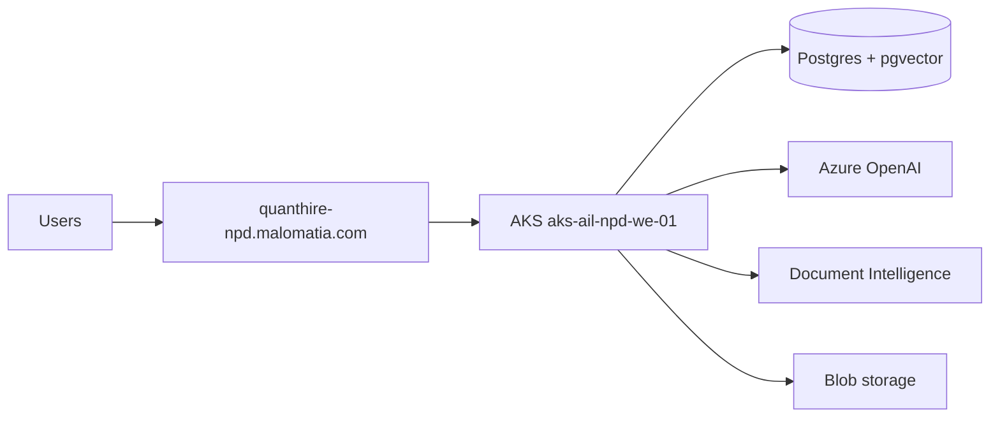
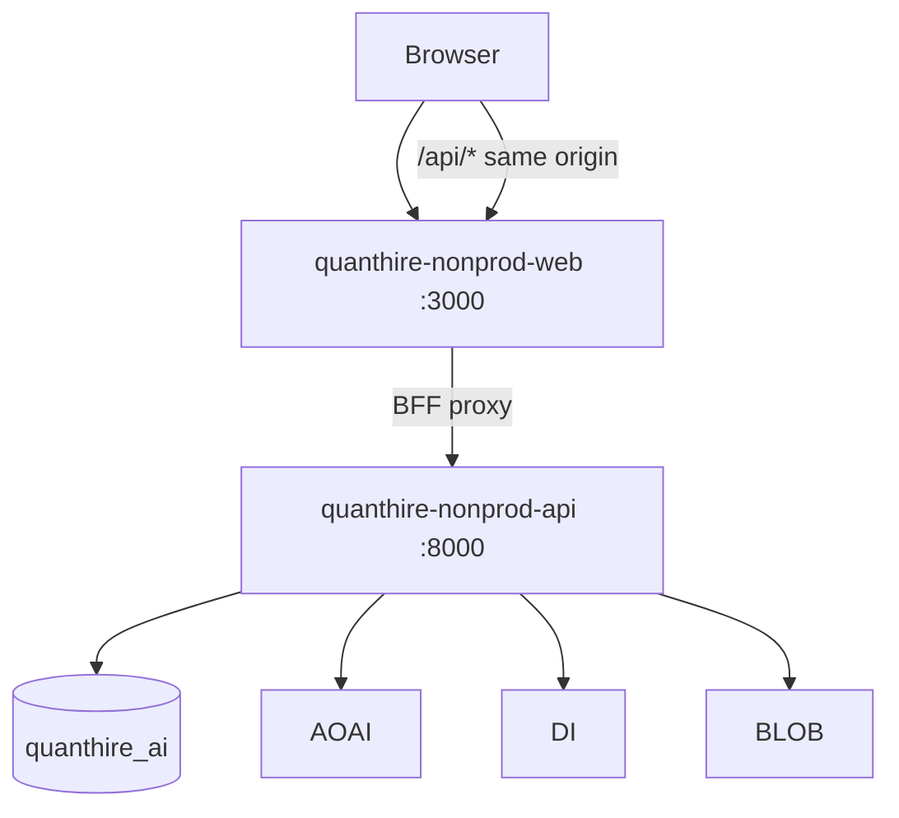

# QuantHire AI — Consolidated Technical Documentation

**Document type:** Technical reference (handover)  
**Product:** QuantHire AI — enterprise AI-native hiring platform  
**Organization:** Malomatia / AI Hub  
**Primary environment documented:** Azure Non-Prod (NPD)  
**Public URL:** https://quanthire-npd.malomatia.com  
**Repository layout:** Monorepo — `apps/web`, `apps/api`, `apps/agents`, `apps/quantchat`, `infra/`  
**Image tag (reference):** `0.1.5`  
**Canonical Kubernetes manifest:** `infra/kubernetes/nonprod/quanthire.yaml`  

**Companion documents (separate deliverables):**

- [LOCAL-SETUP-GUIDE.md](./LOCAL-SETUP-GUIDE.md) — run the repo on a developer machine  
- [QUANTHIRE-BUSINESS-REQUIREMENTS-DOCUMENT-BRD.md](./QUANTHIRE-BUSINESS-REQUIREMENTS-DOCUMENT-BRD.md) — business requirements  
- [KT-MASTER-INDEX.md](./KT-MASTER-INDEX.md) — Session 1–3 KT deep dives  

---

## Table of contents

1. [Executive technical summary](#1-executive-technical-summary)  
2. [Architecture overview](#2-architecture-overview)  
3. [Technology stack](#3-technology-stack)  
4. [Repository and module structure](#4-repository-and-module-structure)  
5. [Runtime request flow](#5-runtime-request-flow)  
6. [Authentication and authorization](#6-authentication-and-authorization)  
7. [Data layer](#7-data-layer)  
8. [AI and agent subsystems](#8-ai-and-agent-subsystems)  
9. [Azure services and configuration](#9-azure-services-and-configuration)  
10. [API surface](#10-api-surface)  
11. [Frontend and BFF](#11-frontend-and-bff)  
12. [Deployment and release](#12-deployment-and-release)  
13. [Observability and quality](#13-observability-and-quality)  
14. [Security and compliance notes](#14-security-and-compliance-notes)  
15. [Known limitations and technical debt](#15-known-limitations-and-technical-debt)  
16. [Reference tables](#16-reference-tables)  

---

## 1. Executive technical summary

QuantHire AI is a **recruitment platform** that combines ATS-style workflows (jobs, candidates, applications, interviews, offers) with **four agentic AI capabilities**:

| Capability | Description |
|------------|-------------|
| **JD generation** | LangGraph multi-step workflow (generate → refine → validate → persist) with HR input matrix enforced in API |
| **Resume parsing** | Azure Document Intelligence + ParsingAgent → structured candidate profile + pgvector indexing |
| **Job matching** | Multi-agent swarm by dimension, evidence verification, debate (Synthesizer / Critic / Arbitrator) |
| **QuantChat** | RAG chatbot over jobs and candidates (intent routing, hybrid retrieval, rerank, grounded generation) |

**Non-Prod deployment model:** Two containers on **AKS** — **Next.js (BFF + UI)** and **FastAPI (API + all agents in-process)**. This is a **modular monolith** split for scaling UI and API independently, not a microservice mesh of agents.

**Vector search on NPD:** **pgvector** in Azure PostgreSQL. Milvus is disabled on NPD (`MILVUS_ENABLED=false`).

**LLM on NPD:** **Azure OpenAI** deployment `gpt-4o` (chat) and `text-embedding-3-large` (embeddings), via unified factory `create_chat_llm` in `apps/agents/agents/llm/chat_factory.py`.

---

## 2. Architecture overview

### 2.1 Context (user to cloud)



Users never connect directly to Postgres or Azure OpenAI; all access is through the web tier and API.

### 2.2 Application topology (NPD)



| Kubernetes object | Name | Role |
|-------------------|------|------|
| Namespace | `quanthire-nonprod` | Isolation |
| Deployment | `quanthire-nonprod-web` | Next.js standalone |
| Deployment | `quanthire-nonprod-api` | FastAPI + agents + QuantChat |
| Service | `quanthire-frontend` | Front door (LoadBalancer / corporate routing) |
| Service | `quanthire-backend` | ClusterIP API |
| ConfigMap | `quanthire-nonprod-config` | Non-secret env |
| Secrets | `quanthire-*-secret` | DB, blob, AOAI, DI, JWT, Entra |

### 2.3 Logical layers

| Layer | Technology | Location |
|-------|------------|----------|
| Presentation | Next.js 14 App Router, React, Tailwind | `apps/web` |
| BFF | Next.js Route Handler `apps/web/src/app/api/[...path]/route.ts` | Proxies to FastAPI |
| API | FastAPI, SQLModel, Alembic | `apps/api` |
| Agents | LangGraph, Crew-style agents, orchestrators | `apps/agents` |
| QuantChat RAG | QueryRouter pipeline | `apps/quantchat` |
| Data | PostgreSQL 14+, pgvector extension | Azure Flexible Server (NPD) |

---

## 3. Technology stack

| Area | Choices |
|------|---------|
| Language (backend) | Python 3.11 |
| Language (frontend) | TypeScript, Node 20 |
| Web framework | FastAPI, Uvicorn (2 workers in production image) |
| UI | Next.js 14, MSAL for Entra SSO |
| ORM / migrations | SQLModel, Alembic |
| LLM orchestration | LangGraph (JD), custom orchestrators (matching), LangChain chat models |
| Container registry | ACR `crailnpdwe01.azurecr.io` |
| Orchestration | AKS `aks-ail-npd-we-01` |
| CI/CD | GitHub Actions `.github/workflows/deploy-nonprod.yml` (and manual Jump VM deploy) |

---

## 4. Repository and module structure

```text
QuantHire AI/
├── apps/
│   ├── web/                 # Next.js UI + BFF
│   ├── api/                 # FastAPI application (app.main)
│   ├── agents/              # JD, matching, parsing agents
│   └── quantchat/           # RAG pipeline (QueryRouter, retrieval, generation)
├── infra/kubernetes/nonprod/  # quanthire.yaml, quanthire-secrets.yaml (templates)
├── tests/unit/              # Python unit tests (CI)
├── Dockerfile.backend
├── Dockerfile.frontend
├── docs/                    # KT and handover documentation
└── .github/workflows/       # CI and deploy pipelines
```

**Critical invariant:** Docker builds run from **repository root** (`docker build -f Dockerfile.backend .`).

**PYTHONPATH (local and Docker):** Must include `apps/api`, `apps/agents`, `apps/agents/agents`, `apps/quantchat` so agents import correctly.

---

## 5. Runtime request flow

### 5.1 Typical authenticated API call

1. Browser calls `https://<host>/api/v1/...` (same origin as UI).  
2. Next.js BFF forwards to `BFF_BACKEND_URL` (in-cluster: `http://quanthire-backend.quanthire-nonprod.svc.cluster.local:8000`).  
3. FastAPI middleware: CORS, RBAC (`require_authenticated_user` on protected routes).  
4. Route handler executes business logic; may invoke agent code in-process.  
5. Response returns through BFF to browser.

### 5.2 Long-running AI operations

JD generation, resume upload/parsing, and job-matching **SSE streams** can exceed default HTTP timeouts. The BFF route uses extended timeouts (~620s) for configured path prefixes.

### 5.3 QuantChat path (summary)

`POST /api/v1/quantchat/ai-chat` → `QueryRouter.route_query` → intent branch → (typical) vector + keyword retrieval → RRF fusion → rerank → context build → RAG answer generation. See `docs/session-3-quick-reference.md` for line-level map.

---

## 6. Authentication and authorization

### 6.1 Modes (`AUTH_MODE`)

| Mode | Use |
|------|-----|
| `none` | Local dev / tests |
| `basic` | Email/password JWT (NPD may use this per ConfigMap) |
| `entra` | Microsoft Entra ID SSO (MSAL in browser, ID token exchange in API) |

### 6.2 Entra (Non-Prod)

| Item | Value |
|------|--------|
| App registration name | **AIL-QUANTHIRE-NPD** |
| Client ID | `221c7e05-6581-4226-9a08-96a4011dd5ce` |
| Tenant ID | `68bae048-c310-4ec2-934f-cbc2588f30fe` |
| App roles (examples) | `ADMIN`, `RECRUITER`, `HIRING_MANAGER`, `INTERVIEWER`, `VIEWER` |

User access is granted by **assigning Entra app roles** (TAMM / Identity team). On login, API upserts user in Postgres and issues QuantHire JWT.

### 6.3 RBAC

Roles map Entra → PostgreSQL enum → JWT claim (`recruiter`, etc.). Middleware enforces route-level permissions. UI role labels in `apps/web/src/lib/format-role.ts`.

---

## 7. Data layer

### 7.1 PostgreSQL (NPD)

| Setting | Typical NPD value |
|---------|-------------------|
| Host | `psql-ail-npd-we-01.postgres.database.azure.com` |
| Database | `quanthire_ai` |
| SSL | `require` |

### 7.2 Core entities (conceptual)

Jobs, candidates, applications, interviews, offers, users, audit/usage logs, vector embeddings (pgvector tables via ingestion services).

### 7.3 Migrations

- Location: `apps/api/alembic/`  
- Post-deploy: `kubectl exec deploy/quanthire-nonprod-api -n quanthire-nonprod -- alembic upgrade head`  
- Local: `alembic upgrade head` from `apps/api` with venv active  

### 7.4 Blob storage (NPD)

Account `dlsailnpdqc01`, containers `quanthire-uploads`, `quanthire-processed` — resume and document artifacts.

---

## 8. AI and agent subsystems

### 8.1 JD generation

- **Entry:** UI `jd-generation-dialog.tsx` → API `jd_generation.py`  
- **Workflow:** `state_machine.py` LangGraph: `generate_jd` → `refine_jd` → `validate_jd` → `prepare_jd` → (NPD skips Milvus) → complete  
- **HR enforcement:** `_apply_hr_inputs_to_jd` overlays recruiter matrix on generated JSON  
- **Tasks:** In-memory task tracking for async JD jobs (`jd_generation_tasks.py`) — not durable Celery on NPD  

### 8.2 Resume parsing

- **Upload validation:** Frontend + API file rules  
- **Extract:** `pdf_extraction.py` / Document Intelligence  
- **Structure:** `ParsingAgent.execute`  
- **Index:** `pgvector_ingestion.add_resume`  

### 8.3 Job matching

- **Stream:** `match_stream` SSE for agent thoughts  
- **Logic:** `_run_swarm` (parallel specialists) → `verify_swarm` → `_run_debate` → `ArbitratorAgent` final verdict  

### 8.4 QuantChat

- Read-only RAG; conversation memory for multi-turn  
- Observability: `AgentObservabilityManager` (in-process traces; optional LangSmith)  

### 8.5 LLM factory

All chat models: `create_chat_llm()` — switches on `LLM_PROVIDER` (`azure_openai`, `openai`, `vertexai`). NPD uses `azure_openai`.

---

## 9. Azure services and configuration

| Service | NPD identifier (reference) | Purpose |
|---------|---------------------------|---------|
| Resource group | `rg-ail-wkload-npd-we-01` | Workload grouping |
| AKS | `aks-ail-npd-we-01` | Runs web + API |
| ACR | `crailnpdwe01` | Container images |
| PostgreSQL | `psql-ail-npd-we-01` | App DB + vectors |
| Azure OpenAI | `aif-ail-npd-we-01` | gpt-4o, embeddings |
| Document Intelligence | `di-ail-npd-we-01` | Resume layout OCR |
| Storage | `dlsailnpdqc01` | Uploads |

**Configuration sources:**

- Non-secrets: ConfigMap in `quanthire.yaml`  
- Secrets: Kubernetes secrets (templates in `quanthire-secrets.yaml` — do not commit real values)  
- Code defaults: `apps/api/app/config.py` (`Settings` pydantic class)  

**Key env flags (NPD):**

```text
DEPLOYMENT_TARGET=azure-nonprod
VECTOR_STORE=pgvector
MILVUS_ENABLED=false
LLM_PROVIDER=azure_openai
LANGGRAPH_CHECKPOINT_BACKEND=memory
```

---

## 10. API surface

Base path: `/api/v1`

| Prefix / area | Module | Notes |
|---------------|--------|-------|
| `/auth` | `auth.py` | Login, SSO config, Entra callback |
| `/jobs` | `jobs.py` | CRUD jobs |
| `/candidates` | `candidates.py` | Candidate records |
| `/applications` | `applications.py` | Applications pipeline |
| `/jd-generation` | `jd_generation.py` | Generate, poll, HR fields |
| `/job-matching` | `job_matching.py` | Match, stream |
| `/quantchat` | `quantchat.py` | AI chat, status |
| `/resume-parsing` | `resume_parsing.py` | Upload, parse |
| `/feedback` | `feedback.py` | Recruiter hiring feedback |
| `/assessments`, `/interviews`, `/offers` | respective routers | Pipeline modules |
| `/gdpr` | `gdpr.py` | GDPR-related endpoints |

Interactive docs (when enabled): `http://<api-host>/docs`

Health: `/healthz`, `/readyz` (readiness includes dependency checks)

---

## 11. Frontend and BFF

| Topic | Detail |
|-------|--------|
| Framework | Next.js 14 App Router under `apps/web/src/app` |
| Dashboard routes | `/dashboard`, jobs, candidates, job-matching, applications, interviews, offers, chat, analytics, settings |
| Auth | `auth-provider.tsx`, MSAL helpers `msal-auth.ts`, login page |
| API client | Calls same-origin `/api/v1/*` (BFF), not raw backend URL from browser |
| Branding | Malomatia-themed landing and JD templates |

**Environment (web):**

- `BFF_BACKEND_URL` — backend target for proxy (required)  
- `AZURE_AD_CLIENT_ID`, `AZURE_AD_TENANT_ID` — public MSAL config (from SSO config API at runtime)  

---

## 12. Deployment and release

### 12.1 Automated (GitHub Actions)

Workflow: `.github/workflows/deploy-nonprod.yml`

- Validates: unit tests, API import, frontend `tsc` + build  
- Builds and pushes `quanthire-backend` and `quanthire-frontend` to ACR  
- `kubectl apply` manifest, rollout restart, Alembic migrate, smoke checks  

### 12.2 Manual (Jump VM / approved workstation)

Detailed steps: **`docs/nonprod-deploy-handover-guide.md`**

Summary: `az login` → `az acr login` → `docker build/push` (both Dockerfiles) → `az aks get-credentials` → `kubectl rollout restart` → `alembic upgrade head`

### 12.3 First-time cluster setup

1. Apply secrets (real values)  
2. `kubectl apply -f infra/kubernetes/nonprod/quanthire.yaml`  
3. Migrations  
4. Run `infra/kubernetes/nonprod/validate-before-apply.cmd` (adjust LB URL if needed)  

---

## 13. Observability and quality

| Mechanism | Status / location |
|-----------|-------------------|
| Structured logs | Python logging in API and QuantChat |
| QuantChat traces | `agent_observability.py` — in-memory dashboard/metrics |
| RAG quality heuristics | `RAGEvaluator` on trace complete |
| Hiring feedback | `POST /feedback` — recruiter outcomes (separate from chat thumbs) |
| LangSmith | Optional via `apps/quantchat/utils/tracing.py` |
| Prometheus | Configurable; disabled on NPD ConfigMap example |
| AI adoption dashboard | `/dashboard/analytics` — usage from Postgres |

**Gap:** Frontend defines observability API paths; some backend routes may need mounting for full dashboard exposure.

---

## 14. Security and compliance notes

- JWT for session; Entra ID tokens validated via JWKS (`entra_auth.py`).  
- Secrets only in Kubernetes / secure stores — not in Git.  
- API pod: non-root, read-only root FS, dropped capabilities (see deployment manifest).  
- CORS and allowed hosts configured for NPD hostnames.  
- GDPR router present for data-subject workflows (verify operational process with legal/compliance).  
- Pseudonymization patterns documented in security hardening (HMAC-SHA256 for sensitive identifiers where applied).  

---

## 15. Known limitations and technical debt

| Area | Limitation |
|------|------------|
| JD async tasks | In-memory; lost on pod restart / multi-replica unless moved to Redis/DB queue |
| Agent scaling | All agents in one API process — heavy CPU/memory per pod |
| Milvus | Legacy paths in code; NPD uses pgvector only |
| QuantChat feedback UI | `record_feedback` in-process; no full thumbs API wired to UI |
| Helm vs raw YAML | NPD canonical deploy is **raw** `quanthire.yaml`, not Helm release |
| Local `.env.example` | May show Vertex defaults; NPD uses Azure OpenAI — align env with `config.py` and ConfigMap |
| Auth on NPD | ConfigMap may show `AUTH_MODE=basic` while Entra is configured for SSO cutover — confirm with platform team |

---

## 16. Reference tables

### 16.1 Documentation map

| Need | Document |
|------|----------|
| Local dev | [LOCAL-SETUP-GUIDE.md](./LOCAL-SETUP-GUIDE.md) |
| Business scope | [QUANTHIRE-BUSINESS-REQUIREMENTS-DOCUMENT-BRD.md](./QUANTHIRE-BUSINESS-REQUIREMENTS-DOCUMENT-BRD.md) |
| KT Sessions 1–3 | [KT-MASTER-INDEX.md](./KT-MASTER-INDEX.md) |
| Full architecture diagrams | [QuantHire-AI-architecture-and-resources.md](./QuantHire-AI-architecture-and-resources.md) |
| Code line references | [agentic-systems-quick-reference.md](./agentic-systems-quick-reference.md), [session-3-quick-reference.md](./session-3-quick-reference.md) |
| NPD deploy script | [nonprod-deploy-handover-guide.md](./nonprod-deploy-handover-guide.md) |
| Azure resource names | [project-resources-inventory.md](./project-resources-inventory.md) |

### 16.2 Contacts and access (process)

| Need | Process |
|------|---------|
| NPD application login | TAMM — Entra app **AIL-QUANTHIRE-NPD**, assign **RECRUITER** (or role) |
| ACR/AKS deploy access | AI Hub platform team |
| NPD DB credentials | Key Vault / K8s secrets — not in repo |

---

**Document status:** Consolidated technical reference for Malomatia handover. For diagram-heavy architecture and trade-off narratives, see Session 1 complete architecture document. For implementation walkthrough, see Session 2 code walkthrough.

*End of consolidated technical documentation.*
