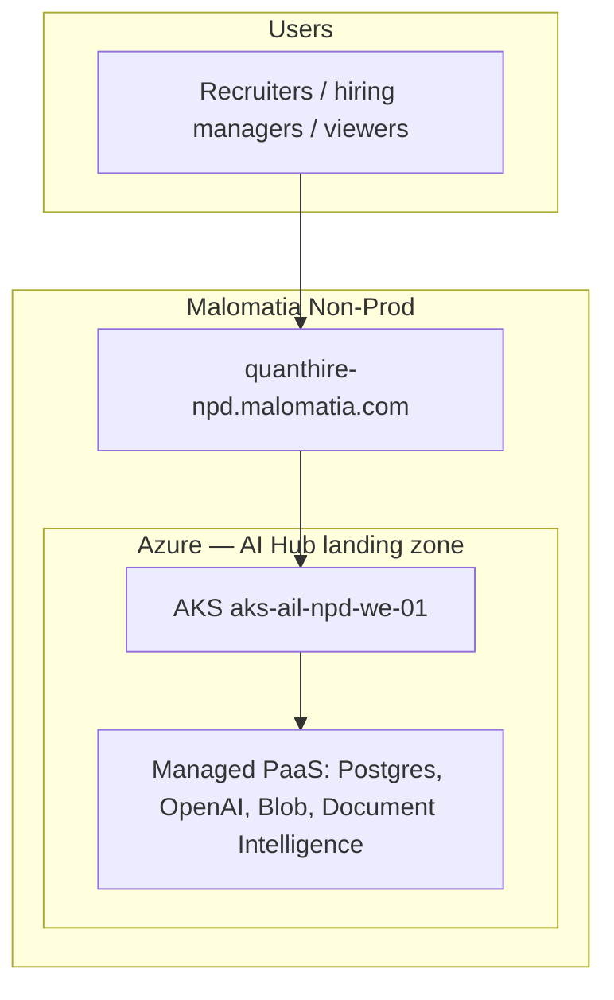
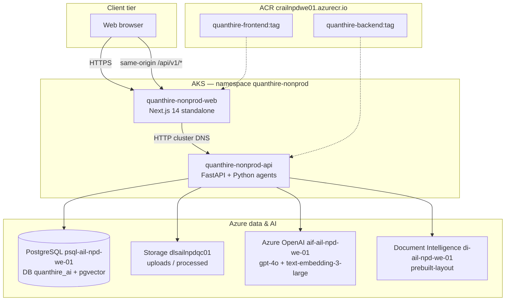
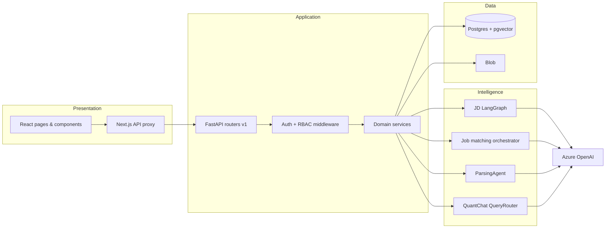
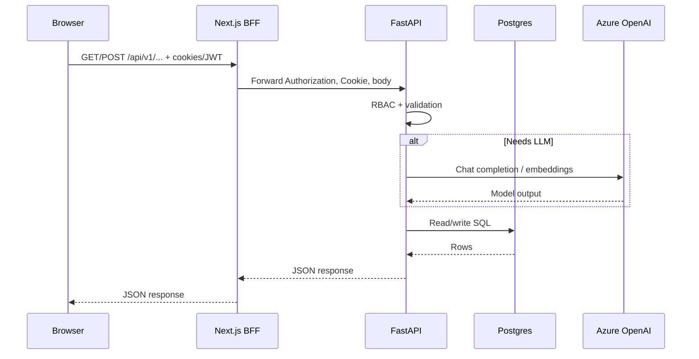
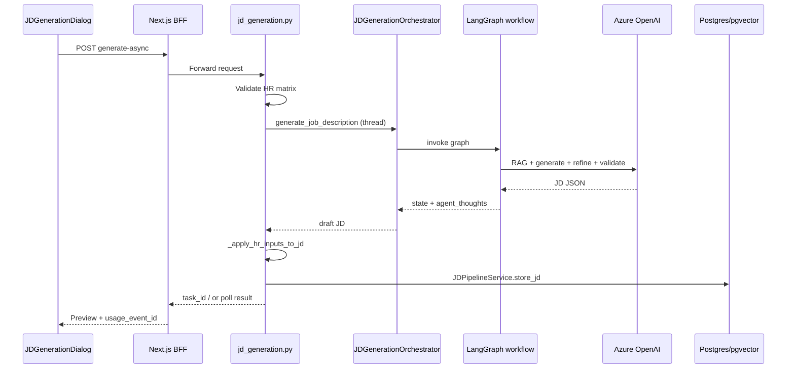
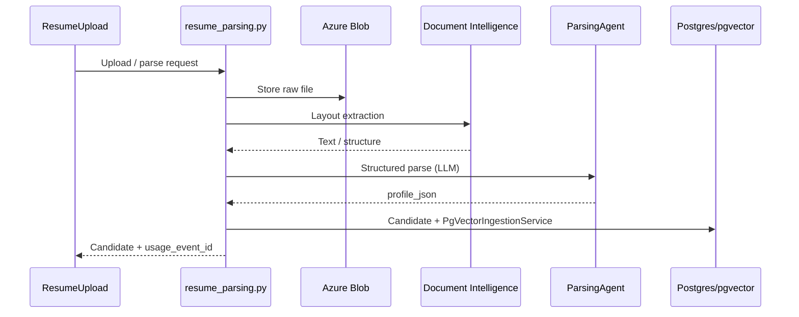
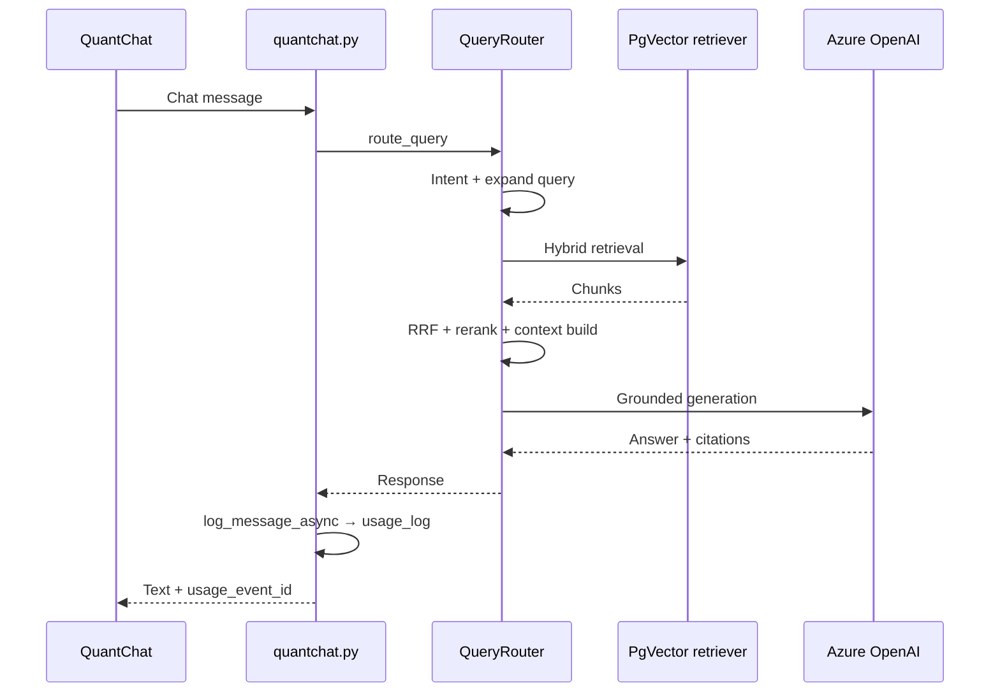
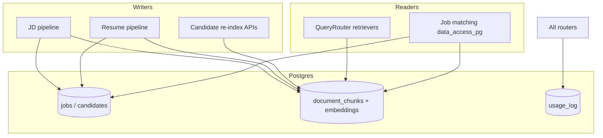

# Session 1 — Architecture & Resources (complete reference)

**QuantHire AI — Malomatia / AI Hub**  
**Session agenda coverage**

1. End-to-end architecture walkthrough, supported by architecture diagrams  
2. Components and how they interact (frontend, backend, agents, data layer)  
3. Infrastructure and services used: Azure resources, database, vector store, LLM services, etc.  
4. Rationale behind each resource: why selected, alternatives considered, trade-offs  

**Document purpose:** Single source of truth for KT, architecture review, and onboarding.  
**Deployment baseline described:** Azure Non-Prod (`DEPLOYMENT_TARGET=azure-nonprod`).  
**Public URL:** https://quanthire-npd.malomatia.com  
**Canonical manifest:** `infra/kubernetes/nonprod/quanthire.yaml`  
**Related docs:** `docs/project-resources-inventory.md`, `docs/jd-generation-architecture.md`, `docs/kt-session-1-presenter-pack.md`

---

# Part I — Product context

## 1.1 What QuantHire is

QuantHire is an **AI-native hiring platform** for enterprise recruiters. It combines traditional ATS-style entities (jobs, candidates, applications, interviews, offers) with **four agentic AI capabilities**:

| # | Capability | User entry | Primary backend |
|---|------------|------------|-----------------|
| 1 | **JD generation** | Dashboard → Jobs → Generate JD | LangGraph workflow + API HR enforcement |
| 2 | **Resume parsing** | Candidates → upload CV | Blob → Document Intelligence → ParsingAgent → Postgres/pgvector |
| 3 | **Job matching** | Job matching views | HSS-D specialist swarm + debate orchestrator |
| 4 | **QuantChat** | QuantChat UI | QueryRouter RAG over indexed jobs/candidates |

**Cross-cutting platform features**

- **Authentication & RBAC** (roles: admin, recruiter, hiring manager, interviewer, candidate, viewer).  
- **AI Hub usage logging** — Postgres `usage_log`, `usage_feedback`, adoption dashboard (`/dashboard/ai-adoption`).  
- **Enterprise JD format** — 15-section Malomatia-aligned job descriptions.  
- **Optional observability** — LangSmith, Sentry, Application Insights / OTel (not all enabled on NPD).

## 1.2 Architectural stance on Non-Prod

QuantHire on NPD is best described as a **modular monolith split across two containers**:

- **Web container** — UI + BFF.  
- **API container** — REST API + **all agent code in-process** (JD, matching, parsing, QuantChat QueryRouter).

This is **not** a fleet of independent agent microservices on NPD. That choice optimizes **time-to-land** on the shared AKS AI Hub footprint and reduces operational complexity, at the cost of **heavier API pods** and some **horizontal scaling constraints** (documented in Part IV).

---

# Part II — End-to-end architecture walkthrough

## 2.1 Level 0 — User to cloud (context diagram)

**Narrative:** Users reach a **public DNS name** fronting **AKS**. The application consumes **Azure-managed data and AI services** in the same landing zone pattern as sibling AI Hub applications. No user traffic hits Postgres or Azure OpenAI directly.

## 2.2 Level 1 — Application topology (primary KT diagram)

**Key request path**

1. Browser loads UI from **frontend** Service (internal LoadBalancer + corporate DNS).  
2. All API calls go to **`/api/...`** on the **same origin** (BFF).  
3. BFF forwards to **`http://quanthire-backend.quanthire-nonprod.svc.cluster.local:8000`**.  
4. FastAPI executes business logic and invokes agent modules **in the same process** (thread pool for CPU-bound / sync LLM calls where used).  
5. Persistence and inference use **Postgres**, **Blob**, **Azure OpenAI**, **Document Intelligence**.

## 2.3 Level 2 — Logical layers

## 2.4 Deployment & networking (NPD)

| Element | Configuration | Notes |
|---------|---------------|-------|
| Namespace | `quanthire-nonprod` | Isolated from other workloads |
| API Deployment | `quanthire-nonprod-api`, replicas **1** | Resource limits ~1 CPU / 2Gi RAM |
| Web Deployment | `quanthire-nonprod-web`, replicas **1** | ~0.5 CPU / 1Gi |
| Service `quanthire-backend` | LoadBalancer, **internal** annotation | Port 8000 → API |
| Service `quanthire-frontend` | LoadBalancer, **internal** | Port 80 → web :3000 |
| ServiceAccount | `quanthire-nonprod` | Pod identity |
| ConfigMap | `quanthire-nonprod-config` | Non-secret env |
| Secrets | 6 K8s secrets (see Part III) | DB, blob, AOAI, DI, JWT, Entra |
| Image pull | `Always` from ACR | e.g. tag **0.1.5** per README |
| API hardening | non-root UID 1000, read-only root FS, drop ALL caps | `quanthire.yaml` |
| Probes | `/healthz`, `/readyz` (API); `/` (web) | Startup tolerance for slow imports |

**Worker / Redis on NPD:** Helm reference sets **worker replicas to 0** and **redis.enabled: false** — background Celery is **not** part of the active NPD topology.

## 2.5 Sequence — authenticated API call (generic)

## 2.6 Sequence — JD generation (representative AI flow)

## 2.7 Sequence — resume upload (NPD)

## 2.8 Sequence — QuantChat

---

# Part III — Infrastructure & services (complete inventory)

## 3.1 Azure resources — Non-Prod (active)

| Category | Resource | Identifier | Role |
|----------|----------|------------|------|
| Governance | Subscription | `6c1005fd-2b1b-40be-a39b-e10615db8ee6` (in config) | Billing / ARM scope |
| Governance | Resource group | `rg-ail-wkload-npd-we-01` | Workload grouping |
| Compute | AKS | `aks-ail-npd-we-01` | Runs web + API |
| Registry | ACR | `crailnpdwe01.azurecr.io` | Container images |
| Database | PostgreSQL Flexible Server | `psql-ail-npd-we-01.postgres.database.azure.com` | OLTP + pgvector |
| Database | Database name | `quanthire_ai` | Application schema |
| AI | Azure OpenAI account | `aif-ail-npd-we-01.openai.azure.com` | Inference API |
| AI | Chat deployment | `gpt-4o` | Agents + RAG generation |
| AI | Embedding deployment | `text-embedding-3-large` | Vector ingest (NPD ConfigMap) |
| Storage | Storage account | `dlsailnpdqc01` | Binary objects |
| Storage | Container | `quanthire-uploads` | Raw uploads |
| Storage | Container | `quanthire-processed` | Processed artifacts |
| AI | Document Intelligence | `di-ail-npd-we-01.cognitiveservices.azure.com` | PDF/layout OCR |
| AI | DI model | `prebuilt-layout` | Layout analysis |
| Identity | Entra app (client ID) | `221c7e05-6581-4226-9a08-96a4011dd5ce` | SSO prepared |
| Identity | Entra tenant | `68bae048-c310-4ec2-934f-cbc2588f30fe` | Directory |
| DNS | Public hostname | `quanthire-npd.malomatia.com` | User-facing entry |

## 3.2 Kubernetes objects (NPD)

| Kind | Name | Purpose |
|------|------|---------|
| Namespace | `quanthire-nonprod` | Isolation |
| ServiceAccount | `quanthire-nonprod` | Pod identity |
| ConfigMap | `quanthire-nonprod-config` | Env: LLM, Postgres host, vector store, storage, DI, auth mode |
| Deployment | `quanthire-nonprod-api` | Backend |
| Deployment | `quanthire-nonprod-web` | Frontend |
| Service | `quanthire-backend` | Internal LB → API :8000 |
| Service | `quanthire-frontend` | Internal LB → web :80 |
| CronJob | `quanthire-nonprod-usage-rollup` | When present in manifest — AI Hub daily rollup |

## 3.3 Secrets (cluster-only)

| Secret | Keys | Consumed by |
|--------|------|-------------|
| `quanthire-db-secret` | `DATABASE_URL` | API |
| `quanthire-blob-secret` | `AZURE_STORAGE_CONNECTION_STRING` | API |
| `quanthire-aoai-secret` | `AZURE_OPENAI_API_KEY` | API |
| `quanthire-di-secret` | `AZURE_DOCUMENT_INTELLIGENCE_KEY` | API |
| `quanthire-auth-secret` | `JWT_SECRET_KEY` | API |
| `quanthire-entra-secret` | `AZURE_AD_CLIENT_SECRET` | API (SSO / Graph when enabled) |

Template: `infra/kubernetes/nonprod/quanthire-secrets.yaml` (placeholders — never commit real values).

## 3.4 Database (PostgreSQL)

**Engine:** Azure Database for PostgreSQL Flexible Server, SSL `require`.

**Responsibilities**

- **Transactional data:** users, jobs (incl. enterprise JD JSON), candidates, applications, interviews, offers, assessments, audit logs.  
- **AI Hub telemetry:** `usage_log`, `usage_feedback`, `usage_daily_summary`.  
- **Vector search:** pgvector-backed tables (e.g. document chunks, job/candidate embeddings) via `PgVectorIngestionService`.

**Schema management:** Alembic migrations under `apps/api/alembic`; post-deploy `alembic upgrade head`.

**Connection:** Async SQLAlchemy/SQLModel (`asyncpg`); pool settings in `config.py` (`db_pool_size`, etc.).

## 3.5 Vector store

| Mode | When | Technology |
|------|------|------------|
| **NPD / Azure** | `VECTOR_STORE=pgvector`, `MILVUS_ENABLED=false` | Embeddings in Postgres |
| **Local dev** | Optional Milvus | `MILVUS_HOST`, Milvus collections — legacy path |

**Ingestion:** `apps/api/app/services/pgvector_ingestion.py` — used by resume pipeline, JD pipeline, candidate re-index.

**Retrieval:** QuantChat `VectorRetriever` → `PgVectorRetriever` on Azure; JD RAG uses `DirectRetriever` (QuantChat retrieval stack).

**Embedding sources**

- NPD ConfigMap: **Azure OpenAI** `text-embedding-3-large`.  
- Codebase standard dimension **768** documented for `BAAI/bge-base-en-v1.5` in QuantChat settings and migrations — teams should treat **model/dimension consistency** as an operational concern when mixing historical data.

## 3.6 LLM services

### 3.6.1 Non-Prod (primary)

| Setting | Value |
|---------|-------|
| `LLM_PROVIDER` | `azure_openai` |
| Endpoint | `https://aif-ail-npd-we-01.openai.azure.com/` |
| API version | `2024-08-01-preview` |
| Chat deployment | `gpt-4o` |
| Embedding deployment | `text-embedding-3-large` |
| Auth | API key via K8s secret |

**Factory:** `apps/agents/agents/llm/chat_factory.py` — `create_chat_llm()` returns LangChain chat model (Azure/OpenAI/Vertex).

### 3.6.2 Supported in code (not NPD default)

| Provider | Typical use | Config |
|----------|-------------|--------|
| Google Vertex AI (Gemini) | Local dev default in `.env.example` | `GCP_PROJECT_ID`, ADC |
| OpenAI API | Dev / fallback | `OPENAI_API_KEY` |
| Anthropic | Optional chains | `ANTHROPIC_API_KEY` |
| Groq | Fast fallback | `GROQ_API_KEY` |
| Amazon Bedrock | Optional enterprise | Bedrock model IDs in settings |

### 3.6.3 LLM Gateway (optional infrastructure)

- Module: `apps/agents/agents/llm/gateway.py`.  
- Initialized in API lifespan with **Redis URL** and daily budget.  
- **JD, matching, and QuantChat primary paths use `create_chat_llm` directly** — gateway is parallel capability for cost routing elsewhere.

## 3.7 Object storage

| Setting (NPD) | Value |
|---------------|-------|
| `STORAGE_TYPE` | `azure_blob` |
| Account | `dlsailnpdqc01` |
| Containers | uploads + processed |

**Local alternative:** `STORAGE_TYPE=local` for development.

## 3.8 Document Intelligence

| Setting (NPD) | Value |
|---------------|-------|
| Enabled | `true` |
| Endpoint | `di-ail-npd-we-01` |
| Model | `prebuilt-layout` |

Used in resume pipeline before LLM parsing for high-quality text/layout.

## 3.9 Identity & auth services

| Mechanism | NPD | Notes |
|-----------|-----|-------|
| JWT (HS256) | Active | `JWT_SECRET_KEY` secret |
| `AUTH_MODE=basic` | ConfigMap | Username/password against Postgres users |
| Entra ID / MSAL | Prepared | Client/tenant in ConfigMap; `@azure/msal-browser` in web; secret for client credential flows |

## 3.10 Observability & platform telemetry

| Service | NPD typical | Purpose |
|---------|-------------|---------|
| Application logs | `LOG_LEVEL=INFO` | Operations |
| Prometheus | Often disabled (`PROMETHEUS_ENABLED=false`) | Metrics scrape |
| LangSmith | Optional env | LLM trace |
| Sentry | Optional DSN | Error tracking |
| Application Insights / OTEL | Optional | Enterprise APM |
| AI Hub usage DB | Postgres | Adoption dashboard + optional external collector |

## 3.11 CI/CD & IaC (repository)

| Asset | Path | Role |
|-------|------|------|
| Non-Prod deploy workflow | `.github/workflows/deploy-nonprod.yml` | Build, test, push ACR, kubectl apply |
| CI | `.github/workflows/ci.yml` | Lint, test, build |
| Docker | `Dockerfile.backend`, `Dockerfile.frontend` | Production images |
| Helm (reference) | `infra/kubernetes/helm/quanthire/` | Staging/prod patterns; NPD uses raw YAML |
| Terraform (reference) | `infra/terraform/azure/` | Modules: network, AKS, Postgres, Redis, storage, Key Vault, monitoring, ACR |
| External Secrets (prod pattern) | `infra/kubernetes/external-secrets/` | Key Vault → K8s |

## 3.12 Optional / reference-only resources

| Resource | Status on NPD | Notes |
|----------|---------------|-------|
| Redis | Off | Celery broker, gateway budgets — Terraform module exists |
| Celery worker | Replicas 0 | `apps/worker` |
| Milvus | Disabled | Local dev legacy |
| Pinecone / Qdrant | Config only | Alternate vector backends |
| Staging Postgres / OpenAI | Helm `values-staging.yaml` | Different hostnames |
| Prod ACR | `quanthireprodacr.azurecr.io` | Production Helm example |

---

# Part IV — Components & interactions (detailed)

## 4.1 Frontend layer (`apps/web`)

### 4.1.1 Technology stack

- **Next.js 14** (standalone output), **React 18**, **TypeScript**.  
- **Tailwind CSS**, **Radix UI**, **TanStack Query/Table**, **axios**.  
- **next-intl** (i18n), **react-hook-form** + zod resolvers.  
- **MSAL** package for Entra browser flows when enabled.

### 4.1.2 Routing & major surfaces

| Route area | Purpose |
|------------|---------|
| `/dashboard/jobs` | Job list, JD generation entry |
| `/dashboard/candidates` | Candidate CRM, resume upload |
| Job matching pages | Match/rank UI, SSE where used |
| QuantChat | Conversational RAG UI |
| `/dashboard/ai-adoption` | Usage aggregates (`view_analytics`) |
| Auth/login | Basic or Entra (config-dependent) |

### 4.1.3 BFF (Backend-for-Frontend)

**File:** `apps/web/src/app/api/[...path]/route.ts`

**Behavior**

- Resolves backend base URL from `BFF_BACKEND_URL` (NPD: cluster service URL).  
- Forwards method, body, and selected headers (`authorization`, `cookie`, `content-type`, correlation IDs).  
- Does **not** forward `content-encoding` (Node fetch decompresses).  
- Extended timeouts for JD generation routes (~620s class).

**Why it exists**

1. **Security** — internal API hostname stays off the public internet.  
2. **Cookies** — same-site session model.  
3. **CORS** — browser only talks to Next origin.  
4. **Operational** — central place for proxy tuning.

### 4.1.4 Client API layer

**File:** `apps/web/src/lib/api.ts`

- Typed helpers for jobs, candidates, JD generation (sync + async + poll), matching, QuantChat, usage feedback.  
- JD async: `generateAsync` → `pollGeneration` (interval ~3s, max attempts ~200).

### 4.1.5 Key UI ↔ API couplings

| UI component | API | AI note |
|--------------|-----|---------|
| `jd-generation-dialog.tsx` | `/v1/jd-generation/*` | Async first; sync fallback |
| `ResumeUpload.tsx` | `/v1/resume-parsing/*` | Returns `usage_event_id` |
| `QuantChat.tsx` | `/v1/quantchat/*` | Feedback on bot `usage_event_id` |
| Match views | `/v1/job-matching/*` | SSE optional |
| `UsageVisitTracker` | `POST /v1/usage/visit` | Adoption metrics |
| `AiHubFeedback` | `POST /v1/usage/feedback` | 1–5 stars |

### 4.1.6 Middleware & security headers

**File:** `apps/web/middleware.ts` — route protection.  
**File:** `next.config.js` — CSP, HSTS, frame denial, MSAL-related script/connect allowances.

---

## 4.2 Backend layer (`apps/api`)

### 4.2.1 Application entry

**File:** `apps/api/app/main.py`

**Startup (conceptual order)**

1. Load `.env`, sync Azure env from settings.  
2. Bootstrap LLM env / Vertex ADC when not on Azure OpenAI.  
3. **Milvus** connect/load — **skipped on NPD** (`milvus_enabled=false`).  
4. Validate JWT secret in hardened envs.  
5. `init_db()` + health check.  
6. Optional Sentry, **LLM Gateway**, MLflow.  
7. Mount routers, middleware, metrics.

### 4.2.2 API surface (`/api/v1`)

**Aggregation:** `apps/api/app/api/v1/__init__.py`

| Router area | Prefix / tags | Auth |
|-------------|---------------|------|
| auth | `/auth` | Public + session |
| jobs, candidates, applications | domain | Protected |
| jd_generation | `/jd-generation` | Protected |
| job_matching | matching routes | Protected |
| quantchat | `/quantchat` | Protected |
| resume_parsing | `/resume-parsing` | Protected |
| usage | `/usage` | Mixed (status public; adoption RBAC) |
| gdpr, interviews, offers, assessments | domain | Protected |

### 4.2.3 Middleware chain (conceptual)

- CORS (`settings.cors_origins`)  
- TrustedHost / security headers  
- Request context, logging, performance  
- Rate limiting  
- RBAC (`require_permission`, role maps in `middleware/rbac.py`)  
- Global exception mapping (`QuantHireException`)

### 4.2.4 Domain services (selected)

| Service | Responsibility |
|---------|----------------|
| `resume_pipeline_service.py` | Blob/DI text → parse → candidate → pgvector |
| `jd_pipeline_service.py` | Persist JD + vector ingest |
| `pgvector_ingestion.py` | Chunking + embedding + storage |
| `usage_log_service.py` | AI Hub telemetry |
| `usage_adoption_service.py` | Dashboard SQL aggregates |
| `jd_generation_tasks.py` | In-memory async JD task registry |

### 4.2.5 Configuration

**File:** `apps/api/app/config.py`

- Central pydantic-settings: deployment target, Azure hostnames, vector store, LLM provider defaults, feature flags, usage logging, CORS, pool sizes.  
- **Azure Non-Prod defaults** baked in for discovery; secrets never in code.

---

## 4.3 Agents & intelligence layer

Agents are **Python packages** on `PYTHONPATH` from the API container (`apps/agents`, `apps/quantchat`).

### 4.3.1 JD generation

| Item | Detail |
|------|--------|
| Entry API | `apps/api/app/api/v1/jd_generation.py` |
| Orchestrator | `agents/jd_generation/orchestrator.py` |
| Workflow | `agents/jd_generation/state_machine.py` (LangGraph) |
| Agents | RAGAgent, JDGeneratorAgent, JDRefinerAgent, JDValidatorAgent (+ Milvus path skipped on Azure) |
| LLM | `llm_runner` + `create_chat_llm` |
| Post-process | API `_apply_hr_inputs_to_jd` — **deterministic HR matrix** |
| Storage | `JDPipelineService.store_jd` when `use_pgvector_pipeline` |
| Async | In-memory tasks — **not durable across restarts/multi-worker** |

See `docs/jd-generation-architecture.md` for graph nodes and edges.

### 4.3.2 Job matching

| Item | Detail |
|------|--------|
| API | `apps/api/app/api/v1/job_matching.py` |
| Orchestrator | `agents/job_matching/orchestrator.py` |
| Pattern | **HSS-D** — preflight load → parallel specialists → bias audit → debate (synthesizer, critic, arbitrator) → insights |
| Data access | `data_access_pg.py` on Azure (pgvector-backed) |
| Output | JSON match result and/or SSE stream |
| LLM | `job_matching/llm_client.py` + chat factory |

### 4.3.3 Resume parsing

| Item | Detail |
|------|--------|
| API | `apps/api/app/api/v1/resume_parsing.py` |
| Pipeline | `ResumePipelineService` |
| Agent | `agents/parsing/agent.py` (`ParsingAgent`) |
| OCR | Document Intelligence (NPD) |
| Enrichment | `resume_completeness.py`, profile merge for UI |
| Index | PgVector ingest for QuantChat/matching |

### 4.3.4 QuantChat (QueryRouter)

| Item | Detail |
|------|--------|
| API | `apps/api/app/api/v1/quantchat.py` |
| Router | `apps/quantchat/core/query_router.py` |
| Pipeline | Normalize → intent → expand → metadata filter → vector + keyword retrieval → RRF fusion → rerank → context build → generate → format |
| Retrieval | `PgVectorRetriever` when on pgvector |
| Memory | Conversation memory module (in-process) |
| Usage | `log_message_async` on bot reply → `usage_event_id` |

**Design rule:** Comments in API stress **one canonical RAG pipeline** — QueryRouter — rather than duplicate Milvus/RAG endpoints.

### 4.3.5 Shared LLM infrastructure

| Module | Role |
|--------|------|
| `chat_factory.py` | Provider selection, model names, Azure/OpenAI/Vertex clients |
| `gateway.py` | Optional Redis-backed budget/tiers |
| `provider.py` | Enum of providers incl. Bedrock |

### 4.3.6 Optional / experimental agent code

- CrewAI JD collaboration (`crew_collaboration.py`) — not hot path.  
- Hiring workflow orchestration (`agents/orchestration/`) — broader HR process automation.  
- MCP calendar server (`apps/mcp_servers/calendar/`) — integration stub.  
- MLOps: LangSmith helpers, MLflow tracker.

---

## 4.4 Data layer — interactions

**Blob:** write-on-upload; API holds reference on candidate/document records.  
**Consistency:** Single Postgres cluster avoids split-brain between OLTP and vectors on NPD.  
**Migrations:** Alembic versions include pgvector setup, usage logging, embedding model metadata.

---

## 4.5 AI Hub usage logging (cross-cutting)

| Piece | Location |
|-------|----------|
| Write service | `usage_log_service.py` |
| Hooks | `usage_log_hooks.py` (feature keys) |
| API | `api/v1/usage.py` |
| Dashboard | `web/.../ai-adoption/page.tsx` |
| Rollup | `usage_rollup_job.py` + optional CronJob |

Features instrumented: `auth`, `jd_generation`, `resume_parse`, `quantchat`, `job_matching`, plus `visit` / `outcome` from UI.

---

# Part V — Rationale, alternatives & trade-offs (exhaustive)

For each decision: **Why selected → Alternatives → Trade-offs → When we might revisit**.

## 5.1 Compute platform: Azure Kubernetes Service (AKS)

**Why selected**

- Aligns with **AI Hub shared landing zone** and sibling applications on `aks-ail-npd-we-01`.  
- Supports **internal LoadBalancers** for VNet/Jump VM access without exposing API publicly.  
- Mature secret + ConfigMap patterns; GitOps-friendly manifest in repo.

**Alternatives considered**

| Alternative | Why not primary for NPD |
|-------------|-------------------------|
| Azure App Service (web + API) | Less alignment with multi-app AKS standard; harder internal-only API pattern |
| Azure Container Apps | Viable; team standardized on existing AKS ops |
| VMs + manual deploy | High ops burden |
| Separate microservice per agent | Faster delivery with monolithic API |

**Trade-offs**

- Requires Kubernetes skills and cluster shared responsibility.  
- **Single API replica** avoids JD async task and singleton issues but limits HA.

**Revisit when:** Production SLOs require multi-replica API with **durable task queue** (Redis/DB) and sticky sessions or stateless redesign.

---

## 5.2 Two-container split: Next.js web + FastAPI api

**Why selected**

- **Separation of concerns:** static/UI/BFF vs Python AI stack.  
- Independent scaling **in theory** (web lighter than API).  
- Different base images (`Dockerfile.frontend` vs `Dockerfile.backend`).

**Alternatives**

- Single container (Next + uvicorn) — simpler deploy, worse image size and coupling.  
- Public API + SPA — exposes backend URL, harder cookie/CORS.

**Trade-offs**

- Two images to build/push; BFF must stay version-compatible with API.  
- Extra network hop **inside cluster** (low latency).

---

## 5.3 Agents in-process (modular monolith)

**Why selected**

- Minimize **network latency** to LLM and DB during multi-step graphs.  
- Single deploy artifact for NPD MVP.  
- Shared memory for orchestrators and config.

**Alternatives**

- Dedicated **agent service** per domain (JD service, chat service).  
- Azure Functions / Container Apps jobs for long runs.

**Trade-offs**

- API pod CPU/memory must size for worst-case JD + matching.  
- Fault isolation: agent crash affects whole API pod.  
- **Horizontal scale** blocked for features using in-memory state.

**Revisit when:** Independent scaling or team ownership boundaries require service extraction.

---

## 5.4 PostgreSQL as system of record

**Why selected**

- Standard relational model for ATS entities.  
- **Azure Flexible Server** managed backups, SSL, private networking patterns in Terraform modules.  
- Team familiarity; Alembic already integrated.

**Alternatives**

- Cosmos DB, SQL Server — less alignment with pgvector ecosystem in repo.

**Trade-offs**

- Connection pool tuning under concurrent LLM workloads.  
- NPD uses **TIMESTAMP WITHOUT TIME ZONE** in places — app uses naive UTC helpers for asyncpg compatibility.

---

## 5.5 pgvector (in Postgres) vs dedicated vector DB

**Why selected**

- **One operational surface** for backups, monitoring, access control.  
- Sufficient recall/latency for NPD candidate/job corpus sizes.  
- Simplifies QuantChat + matching + ingest **one source of truth**.

**Alternatives considered**

| Alternative | Notes |
|-------------|-------|
| **Milvus** | Used in early/local stack; code still present |
| **Pinecone / Qdrant** | Config hooks in `settings`; not NPD |
| **Azure AI Search** | Not current baseline in manifest |

**Trade-offs**

- ANN performance tuning less flexible than Milvus at very large scale.  
- Embedding dimension/model changes require migration discipline (see Alembic bge migrations).

**Historical decision:** Azure replatform explicitly set `MILVUS_ENABLED=false` and `VECTOR_STORE=pgvector`.

---

## 5.6 Azure OpenAI for inference (NPD)

**Why selected**

- Enterprise contract, **regional deployment**, unified billing with AI Hub.  
- **Private endpoint patterns** compatible with landing zone.  
- Single chat + embedding deployment names in ConfigMap.

**Alternatives**

| Alternative | Role in repo |
|-------------|--------------|
| Vertex AI (Gemini) | Default local `.env.example` |
| Public OpenAI | Dev keys |
| Groq / Anthropic / Bedrock | Fallbacks and experiments |

**Trade-offs**

- Model lock-in to deployed Azure models (`gpt-4o`).  
- Cost per JD/matching/debate run — quality vs spend.  
- Code maintains multi-provider factory — **test matrix cost**.

---

## 5.7 Azure Blob for documents

**Why selected**

- Durable storage for **compliance and reprocessing**.  
- Matches Terraform storage module and enterprise storage account naming.

**Alternatives:** Local disk (dev only), S3 (config exists for other clouds).

**Trade-offs:** Connection string rotation; egress costs; must secure containers.

---

## 5.8 Document Intelligence for resumes

**Why selected**

- Superior **layout-aware extraction** vs raw PDF text for recruiting CV formats.

**Alternatives:** PyPDF-only, open-source OCR, in-LLM vision on full PDF.

**Trade-offs:** Per-page cost; dependency on Azure cognitive endpoint availability.

---

## 5.9 Next.js BFF vs direct API exposure

**Why selected** — see §4.1.3.

**Alternatives:** API Management in front of FastAPI; mutual TLS browser certs (rejected for UX).

**Trade-offs:** BFF becomes critical path — must monitor and scale with UI.

---

## 5.10 Auth: basic + Entra readiness

**Why selected**

- **Basic auth** unblocks UAT without full SSO cutover.  
- Entra IDs in ConfigMap + MSAL on web for planned SSO.

**Alternatives:** Entra-only from day one ( slower integration ).

**Trade-offs:** Basic auth operational burden; must migrate to SSO for enterprise policy.

---

## 5.11 LangGraph checkpoint: memory (NPD)

**Why selected**

- Config comment: avoid Postgres checkpointer **setup hangs** on UAT.  
- JD runs are **single-request** oriented on NPD.

**Alternatives:** Postgres checkpoint backend (Helm staging reference).

**Trade-offs:** No durable mid-graph human-in-the-loop resume after pod restart.

---

## 5.12 Redis / Celery worker disabled on NPD

**Why selected**

- Reduce moving parts — no Redis cluster to operate on NPD.  
- Long work runs in API process (threads/async tasks).

**Alternatives:** Enable Redis module from Terraform; scale workers for async resume/JD.

**Trade-offs:** API latency under load; no distributed task queue.

---

## 5.13 AI adoption metrics in Postgres (AI Hub pattern)

**Why selected**

- **Canonical schema** aligned with sister AI Hub apps.  
- In-app dashboard without depending on external BI for NPD.  
- Pseudonymized `user_ref`, PII scrubbing on payloads.

**Alternatives:** App Insights only, custom analytics warehouse.

**Trade-offs:** Must operate DB migrations and rollup job; dual telemetry if App Insights also enabled.

---

## 5.14 Observability defaults on NPD

**Why Prometheus often off**

- Reduce scrape overhead and operational noise during UAT.

**Alternatives:** Enable Prometheus + Grafana configs in `infra/monitoring/`.

**Trade-offs:** Less out-of-box SRE metrics; rely on logs + Azure Monitor at platform layer.

---

## 5.15 Repository & delivery: GitHub Actions + ACR + kubectl

**Why selected**

- Repeatable pipeline in `.github/workflows/deploy-nonprod.yml`.  
- `kubectl apply` manifest is **explicit** for Jump VM workflows (documented in README/yaml headers).

**Alternatives:** Helm-only deploy, Terraform apply for K8s resources.

**Trade-offs:** Helm values-nonprod marked **reference only** — drift risk if both Helm and raw YAML edited.

---

# Part VI — Operational reference

## 6.1 Deploy checklist (NPD)

1. Build/push images to ACR (`quanthire-backend`, `quanthire-frontend`).  
2. `kubectl apply -f infra/kubernetes/nonprod/quanthire.yaml`.  
3. Ensure secrets applied (`quanthire-secrets.yaml` with real values on cluster).  
4. `kubectl exec deploy/quanthire-nonprod-api -n quanthire-nonprod -- alembic upgrade head`.  
5. Smoke: login, JD generate, resume upload, QuantChat, AI adoption page.

## 6.2 Known architectural limitations (state honestly in KT)

| Limitation | Impact | Mitigation direction |
|------------|--------|----------------------|
| JD async tasks in-memory | Lost on restart; broken with multi-worker | DB task store or sync generate; `UVICORN_WORKERS=1` |
| Singleton orchestrators | One graph instance per process | Accept for NPD or extract service |
| LLM Gateway not on hot path | Central budget enforcement incomplete | Wire JD/matching through gateway |
| Embedding model metadata history | bge vs AOAI naming in migrations | Operational runbook for re-embed |
| Internal LB only | Requires corporate network/VPN path to NPD | By design for UAT |

## 6.3 Environment comparison matrix

| Dimension | Local dev | Azure NPD |
|-----------|-----------|-----------|
| `DEPLOYMENT_TARGET` | local | azure-nonprod |
| Compute | Processes / Docker | AKS |
| LLM | Vertex / OpenAI common | Azure OpenAI |
| Vectors | pgvector ± Milvus | pgvector only |
| Files | local | Blob |
| OCR | optional / simplified | Document Intelligence |
| Auth | none or basic | basic (+ Entra ready) |
| Usage logging | env toggle | ConfigMap `USAGE_LOGGING_ENABLED` when set |
| Milvus startup | may auto-load | disabled |

---

# Part VII — Appendices

## Appendix A — ConfigMap env snapshot (NPD, non-secret)

From `infra/kubernetes/nonprod/quanthire.yaml` — illustrative; verify live manifest:

- `DEPLOYMENT_TARGET=azure-nonprod`, `APP_ENV=nonprod`, `AUTH_MODE=basic`  
- Postgres host/db/port/sslmode  
- `LLM_PROVIDER=azure_openai`, `LLM_MODEL=gpt-4o`  
- Azure OpenAI endpoint, API version, chat + embedding deployments  
- Storage account + containers  
- Document Intelligence endpoint + model  
- `VECTOR_STORE=pgvector`, `MILVUS_ENABLED=false`  
- `LANGGRAPH_CHECKPOINT_BACKEND=memory`  
- `BFF_BACKEND_URL` cluster DNS  
- `PROMETHEUS_ENABLED=false`

## Appendix B — Key source files (screen-share index)

| Topic | Path |
|-------|------|
| NPD manifest | `infra/kubernetes/nonprod/quanthire.yaml` |
| Settings / Azure names | `apps/api/app/config.py` |
| BFF | `apps/web/src/app/api/[...path]/route.ts` |
| API routers | `apps/api/app/api/v1/__init__.py` |
| QueryRouter | `apps/quantchat/core/query_router.py` |
| JD graph | `apps/agents/agents/jd_generation/state_machine.py` |
| Matching orchestrator | `apps/agents/agents/job_matching/orchestrator.py` |
| Resume pipeline | `apps/api/app/services/resume_pipeline_service.py` |
| pgvector ingest | `apps/api/app/services/pgvector_ingestion.py` |
| LLM factory | `apps/agents/agents/llm/chat_factory.py` |
| Usage adoption | `apps/api/app/services/usage_adoption_service.py` |
| Resource list | `docs/project-resources-inventory.md` |

## Appendix C — FAQ

**Is QuantHire a microservices architecture?**  
No on NPD — **two services**, agents as libraries.

**Where is the vector database?**  
**pgvector inside PostgreSQL** on Azure NPD.

**Which LLM do we use in production-like NPD?**  
**Azure OpenAI** deployment **gpt-4o** (+ embedding deployment).

**How does the browser reach FastAPI?**  
**Next.js BFF** proxy only.

**What is AI Hub integration?**  
Usage logging schema, optional rollup to collector URL, alignment with platform Azure OpenAI and AKS footprint — not a separate QuantHire-hosted “hub” service.

**Can we run Milvus on NPD again?**  
Would conflict with current ingest/retrieval defaults unless re-engineered.

---

*End of Session 1 complete document.*
