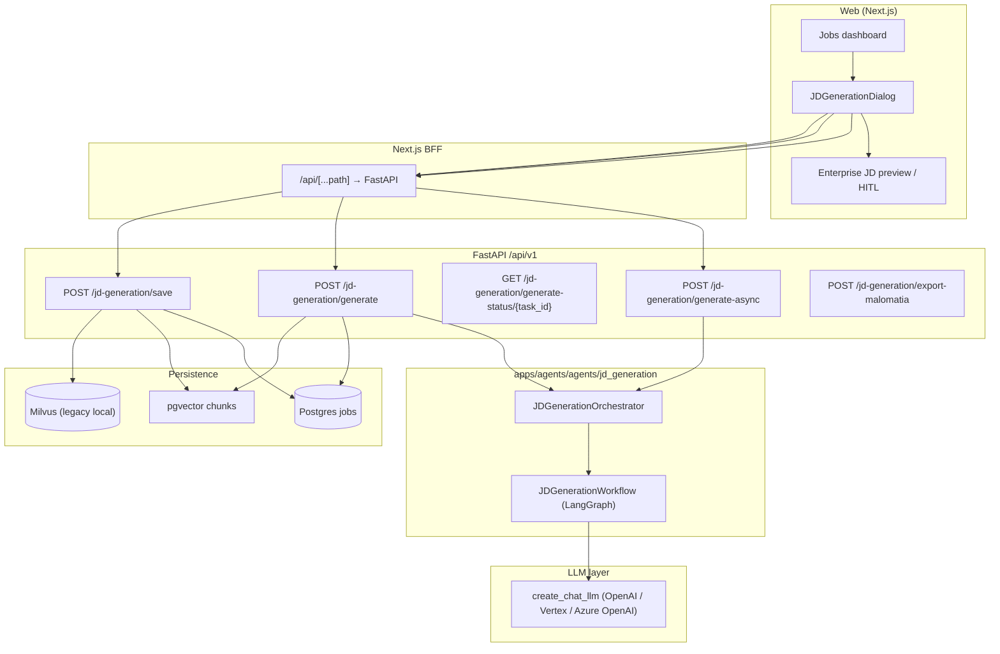
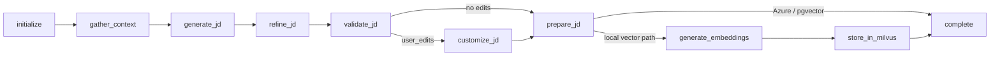

# JD Generation — system architecture (as implemented)

QuantHire generates **enterprise 15-section job descriptions** via a **LangGraph workflow** of specialized LLM agents, exposed through FastAPI and a Next.js dialog. Azure Non-Prod persists to **Postgres + pgvector** after generation; local dev may use **Milvus** via `/save`.

## High-level context



## Request paths: sync vs async

| Path | When used | Behavior |
|------|-----------|----------|
| **Async (preferred)** | UI `generateAsync` → poll | `202` + `task_id`; background task runs orchestrator; client polls `generate-status` (~3s, up to ~10 min) |
| **Sync (fallback)** | Async returns 404/405 | Single `POST /generate` with **10 min** client timeout; same core logic on request thread |

**Task registry** (`jd_generation_tasks.py`): in-process dict, thread lock, **1h TTL**. Not durable across API restarts or multiple Uvicorn workers without sticky routing — prefer **sync** or **single worker** when async poll must be reliable.

**Orchestrator singleton**: one `JDGenerationOrchestrator` per API process (lazy init under lock).

## API core pipeline

Shared by sync and async (`_execute_jd_generation_core`):

1. Resolve and validate HR matrix inputs (`_resolve_generation_inputs`).
2. `asyncio.to_thread(orchestrator.generate_job_description, …, preserve_hr_inputs=True)`.
3. Deterministic **`_apply_hr_inputs_to_jd`** — stamps HR fields, level-sensitive sections, conformance metadata (independent of LLM drift).
4. If `use_pgvector_pipeline` (Azure NPD default): **`JDPipelineService.store_jd`** — upsert job row + vector ingest.

Usage logging (AI Hub): `log_run_started` → terminal `log_run_success_async` / `log_run_failed`; response may include `metadata.usage_event_id` for star feedback.

## LangGraph workflow

**Module:** `apps/agents/agents/jd_generation/state_machine.py`  
**State:** `JDGenerationState` (inputs, RAG context, draft/refined/validated JD, `job_id`, `agent_thoughts`, errors).



| Node | Agent / component | Purpose |
|------|-------------------|---------|
| `gather_context` | `RAGAgent` | Similar JDs via QuantChat `DirectRetriever` (OTPAR observe/plan) |
| `generate_jd` | `JDGeneratorAgent` | Initial 15-section JSON from `enterprise_prompts` |
| `refine_jd` | `JDRefinerAgent` | Second pass for tone, structure, completeness |
| `validate_jd` | `JDValidatorAgent` | Validation; optional auto-fix |
| `customize_jd` | Workflow | Merge `user_edits` when present |
| `prepare_jd` | Workflow | Assign `job_id` UUID |
| `generate_embeddings` / `store_in_milvus` | `MilvusStorageAgent` | **Skipped on Azure** (`should_skip_local_vector_storage`) — storage via API pipeline |
| `complete` | Workflow | Set `workflow_complete`, finalize thoughts |

**Checkpointer:** `langgraph_checkpointer.py` — MemorySaver by default on Azure; optional Postgres checkpointer.

**Tracing:** LangSmith `@traceable` on orchestrator, nodes, and agents when configured (`JDGenerationConfig` / `LANGCHAIN_TRACING_V2`).

## Agent stack (not a dynamic “swarm”)

Production hot path is a **fixed pipeline** of role-named agents (`crew_agents.py`), each extending `AutonomousAgent` with optional OTPAR features (`autonomous_features.py`):

| Class | Role |
|-------|------|
| `RAGAgent` | Retrieve similar jobs for context |
| `JDGeneratorAgent` | Primary generation |
| `JDRefinerAgent` | Refinement |
| `JDValidatorAgent` | QA / fix |
| `MilvusStorageAgent` | Embeddings for local Milvus path |

LLM calls use **`llm_runner.invoke_prompt_with_retry`** and **`create_chat_llm`** — **not** the Redis LLM Gateway (`llm/gateway.py`), which is initialized for other agents but not wired into JD today.

**CrewAI hierarchical crew** (`crew_collaboration.py`) exists for experimentation; it is **not** invoked by `JDGenerationWorkflow.run`.

## Orchestrator post-processing

**Module:** `orchestrator.py`

After the graph returns:

- Malomatia template defaults where applicable.
- Title / department enforcement and responsibility deduplication.
- With `preserve_hr_inputs=True` (API default): **no** extra relevance LLM pass; HR matrix enforced at API layer.
- Retries on `WorkflowError` / `AgentError` via `retry.py`.

## Frontend flow

| Piece | Location | Role |
|-------|----------|------|
| Entry | `dashboard/jobs/page.tsx`, `jobs/[id]/page.tsx` | Open dialog (create or edit) |
| Dialog | `jd-generation-dialog.tsx` | HR matrix form, generate, poll/thoughts, preview |
| Types | `types/enterprise-jd.ts` | 15-section model |
| Persist | `jd-persist.ts` | Hydrate from job, save to backend |
| Preview | `enterprise-jd-preview-card.tsx` | HITL edit, Malomatia export, usage feedback / outcomes |
| API client | `lib/api.ts` | `generate`, `generateAsync`, `pollGeneration`, `save` |

User flow: fill HR matrix → generate (async first) → review `agent_thoughts` + preview → edit sections → save (or rely on auto-save when `job_id` / pgvector pipeline applies).

## Storage matrix

| Environment | After successful generate | Manual save |
|-------------|---------------------------|-------------|
| **Azure NPD (`use_pgvector_pipeline`)** | Auto `JDPipelineService.store_jd` | `/save` updates same job by `job_id` |
| **Legacy local** | Graph may run embed/Milvus nodes (store often deferred) | `/save` → Milvus / ingestion helpers |

## Configuration & observability

| Concern | Mechanism |
|---------|-----------|
| LLM provider / models | `JDGenerationConfig`, env `JD_GENERATION_*`, `chat_factory.py` |
| LLM readiness | `GET /jd-generation/test`, orchestrator fail-fast if not configured |
| Agent thoughts | Returned in API response → dialog UI |
| Usage / adoption | `FEATURE_JD_GENERATION` run events in `usage_log` |
| Export | `malomatia_jd_export.py` → DOCX |

## Key file index

```
apps/web/src/components/jobs/jd-generation-dialog.tsx
apps/web/src/lib/api.ts
apps/api/app/api/v1/jd_generation.py
apps/api/app/services/jd_generation_tasks.py
apps/api/app/services/jd_pipeline_service.py
apps/agents/agents/jd_generation/orchestrator.py
apps/agents/agents/jd_generation/state_machine.py
apps/agents/agents/jd_generation/crew_agents.py
apps/agents/agents/jd_generation/enterprise_prompts.py
apps/agents/agents/jd_generation/config.py
apps/agents/agents/llm/chat_factory.py
```

## Operational notes

1. **Two enforcement layers:** LLM agents draft JSON; API **`_apply_hr_inputs_to_jd`** is the source of truth for HR matrix fields shown to recruiters.
2. **Async tasks are in-memory** — multi-worker or pod restart breaks in-flight polls unless architecture is adjusted (DB-backed tasks or sync generate).
3. **JD does not use LLM Gateway routing** — direct LangChain chat models with configured primary/fallback models.
