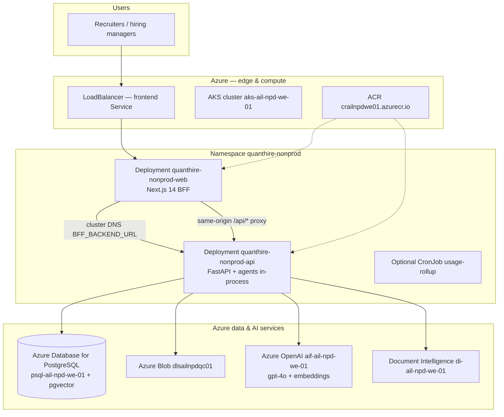

# KT Session 1 — Architecture & Resources

**Audience:** AI / platform stakeholders  
**Product:** QuantHire AI (Malomatia Non-Prod: https://quanthire-npd.malomatia.com)  
**Goal:** End-to-end walkthrough, component interactions, Azure footprint, and **why** each resource was chosen.

---

## 1. What QuantHire is (30 seconds)

QuantHire is an **AI-native hiring platform** with four production AI capabilities:

| Capability | User-facing entry | Backend / agents |
|------------|-------------------|------------------|
| **JD generation** | Jobs → Generate JD | LangGraph multi-agent workflow |
| **Resume parsing** | Candidates → upload | Blob + Document Intelligence + ParsingAgent + pgvector |
| **Job matching** | Job matching UI | HSS-D specialist swarm + debate layer |
| **QuantChat** | QuantChat | QueryRouter RAG pipeline |

Cross-cutting: **RBAC auth**, **Postgres** system of record, **AI Hub usage logging** (`usage_log` / adoption dashboard), optional **LangSmith** tracing.

---

## 2. End-to-end architecture (explain with this diagram)

**One-liner for the room:**  
Browsers hit **Next.js on AKS**; the **BFF proxies** `/api/*` to **FastAPI** inside the cluster; the API talks to **Postgres (incl. vectors)**, **Blob**, **Azure OpenAI**, and **Document Intelligence**. Agent code runs **in the API container** (not a separate agent microservice on NPD today).

---

## 3. Repository layout (monorepo)

| Path | Role |
|------|------|
| `apps/web` | Next.js UI, middleware/JWT, BFF catch-all route |
| `apps/api` | FastAPI, SQLModel, Alembic, domain services |
| `apps/agents/agents` | JD generation, job matching, parsing, LLM factory |
| `apps/quantchat` | QueryRouter RAG stack (retrieval, fusion, generation) |
| `apps/worker` | Celery tasks (optional; **worker replicas = 0 on NPD**) |
| `infra/kubernetes/nonprod/quanthire.yaml` | **Canonical NPD deploy manifest** (kubectl apply) |
| `tests/unit` | Pre-deploy gate in CI |

**Design choice:** Co-locate agents with API for NPD to reduce moving parts; trade-off is **heavier API pods** and **in-memory async tasks** (JD poll) unless worker count / task store changes.

---

## 4. Component interactions

### 4.1 Frontend (`apps/web`)

- **App Router** dashboards: jobs, candidates, matching, QuantChat, AI adoption.
- **Auth:** JWT in httpOnly cookie pattern via auth provider; `middleware.ts` protects routes.
- **BFF:** `src/app/api/[...path]/route.ts` forwards to `BFF_BACKEND_URL` (cluster service `quanthire-backend:8000`).
- **Why BFF:** Browser never holds backend URL; cookies/CORS simplified; long timeouts for JD generate proxied server-side.

### 4.2 Backend (`apps/api`)

- **FastAPI** with layered middleware: CORS, RBAC, rate limit, security headers, structured logging.
- **Routers:** `jobs`, `candidates`, `jd_generation`, `job_matching`, `quantchat`, `resume_parsing`, `usage`, `auth`, etc.
- **Services:** pipeline orchestration (resume, JD store), `PgVectorIngestionService`, usage logging, blob/DI clients.
- **Database:** async SQLAlchemy/SQLModel; Alembic migrations on deploy.

### 4.3 Agents (in-process)

| Feature | Package | Pattern |
|---------|---------|---------|
| JD | `agents/jd_generation` | LangGraph linear pipeline + API HR enforcement |
| Matching | `agents/job_matching` | HSS-D: specialists → debate → insights; SSE stream optional |
| Resume parse | `agents/parsing` | ParsingAgent LLM structured extract |
| QuantChat | `apps/quantchat` | QueryRouter: intent → hybrid retrieval → rerank → generate |

**LLM access:** `agents/llm/chat_factory.py` — `LLM_PROVIDER=azure_openai` on NPD.  
**Not on hot path today:** Redis **LLM Gateway** (budget/routing) — initialized optionally; JD/matching/chat use direct chat models.

### 4.4 Data layer

| Store | Holds |
|-------|--------|
| **Postgres** | Users, jobs, candidates, applications, audit, `usage_log`, embeddings in **pgvector** tables |
| **Blob** | Raw/processed resume uploads |
| **Milvus** | Legacy **local dev** vector store; **disabled on Azure** (`MILVUS_ENABLED=false`) |

**Single RAG read path on Azure:** retrievers use **pgvector** via `PgVectorRetriever` / ingestion service — aligned with “one canonical pipeline” (QueryRouter).

---

## 5. Azure infrastructure & services (NPD)

Reference: `infra/kubernetes/nonprod/quanthire.yaml`, `apps/api/app/config.py`, `.env.example`.

| Resource | Name / endpoint (NPD) | Used for |
|----------|------------------------|----------|
| **Resource group** | `rg-ail-wkload-npd-we-01` | Workload grouping |
| **AKS** | `aks-ail-npd-we-01` | Runs web + API pods |
| **ACR** | `crailnpdwe01.azurecr.io` | Images `quanthire-backend`, `quanthire-frontend` (e.g. tag `0.1.5`) |
| **PostgreSQL Flexible Server** | `psql-ail-npd-we-01.postgres.database.azure.com` / DB `quanthire_ai` | OLTP + pgvector |
| **Azure OpenAI** | `aif-ail-npd-we-01.openai.azure.com` | Chat: `gpt-4o`; embeddings: `text-embedding-3-large` |
| **Storage account** | `dlsailnpdqc01` | Containers `quanthire-uploads`, `quanthire-processed` |
| **Document Intelligence** | `di-ail-npd-we-01` | PDF/layout extraction (`prebuilt-layout`) |
| **Entra ID** (config present) | App registration in ConfigMap | SSO path prepared; NPD may run `AUTH_MODE=basic` until Entra cutover |
| **Public URL** | `quanthire-npd.malomatia.com` | Frontend LoadBalancer / DNS |

**Secrets (AKS, not in Git):** `quanthire-db-secret`, `quanthire-blob-secret`, `quanthire-aoai-secret`, `quanthire-di-secret`, `quanthire-auth-secret`, optional Entra secret.

**Deploy flow:** GitHub Actions `deploy-nonprod.yml` → build/push ACR → `kubectl apply` manifest → post-deploy `alembic upgrade head`.

---

## 6. Rationale, alternatives, trade-offs

Use this table in the KT when asked “why X?”

### Compute: AKS + two deployments (web, api)

| Why chosen | Alternatives considered | Trade-offs |
|------------|-------------------------|------------|
| Fits enterprise AI Hub landing zone; shared cluster with other AIL workloads | App Service only, Container Apps, VM | More ops surface than PaaS-only; good fit for BFF+API split and private DB |
| **API replicas: 1** on NPD | HPA, multi-replica | Simple ops; **in-memory JD async tasks** and singleton orchestrators don’t scale horizontally without redesign |
| **Worker: 0** | Celery workers on Redis | Resume/JD mostly synchronous in API; Redis **not enabled** on NPD Helm values — fewer dependencies |

### Database: Azure PostgreSQL + pgvector

| Why chosen | Alternatives | Trade-offs |
|------------|--------------|------------|
| One database for relational + vectors; simpler backup/compliance | Milvus, Pinecone, Qdrant as primary | pgvector sufficient for NPD scale; less specialized ANN tuning than dedicated vector DB |
| Same connection pool as app data | Separate vector service | Lower latency ops; schema migrations co-managed with Alembic |

**Historical note:** Local dev used **Milvus**; Azure replatform **turned Milvus off** and routed ingestion/retrieval through **PgVectorIngestionService**.

### LLM: Azure OpenAI (NPD)

| Why chosen | Alternatives | Trade-offs |
|------------|--------------|------------|
| Data residency / enterprise contract on Azure AI Hub | Vertex AI (default in local `.env.example`), OpenAI public API, Groq, Bedrock configs in code | Code supports multi-provider via `chat_factory`; NPD standardizes on **one** provider for supportability |
| Deployments `gpt-4o` + `text-embedding-3-large` | Smaller/faster models for cost | Quality for JD/matching/debate; higher cost per run |

**Local dev:** Often **Vertex AI (Gemini)** with ADC — same agent code, different env.

### Document Intelligence

| Why chosen | Alternatives | Trade-offs |
|------------|--------------|------------|
| Robust PDF/layout OCR for resumes | PyPDF only, open-source OCR | Per-page cost; much better structure for parsing agent input |

### Blob storage

| Why chosen | Alternatives | Trade-offs |
|------------|--------------|------------|
| Durable raw file store; aligns with Azure landing zone | Local disk in container | Requires connection string secret; enables reprocessing |

### Frontend: Next.js BFF

| Why chosen | Alternatives | Trade-offs |
|------------|--------------|------------|
| Same-origin API calls; hide internal service URL | SPA calling public API gateway directly | Extra hop latency (minimal inside cluster); must tune proxy timeouts (JD ~10 min) |

### LangGraph checkpoint: Memory (NPD ConfigMap)

| Why chosen | Alternatives | Trade-offs |
|------------|--------------|------------|
| Avoid Postgres checkpointer setup hangs on UAT | `LANGGRAPH_CHECKPOINT_BACKEND=postgres` (Helm staging reference) | No durable human-in-the-loop resume of graph mid-flight across restarts |

### AI adoption metrics: Postgres `usage_log`

| Why chosen | Alternatives | Trade-offs |
|------------|--------------|------------|
| AI Hub standard schema; in-app dashboard | Only App Insights | Dual optional telemetry (App Insights init in web); canonical for adoption is Postgres |

---

## 7. Feature-specific data flows (talk track)

### JD generation

1. UI → `POST /v1/jd-generation/generate-async` (or sync fallback).  
2. API → `JDGenerationOrchestrator` → LangGraph (RAG context → generate → refine → validate).  
3. API **stamps HR matrix** after LLM.  
4. Auto-save: `JDPipelineService` → Postgres job row + pgvector chunks.  
5. Usage: `usage_log` run events + optional star feedback.

See also: `docs/jd-generation-architecture.md`.

### Resume upload (NPD)

1. Upload → **Blob**.  
2. **Document Intelligence** → text.  
3. **ParsingAgent** → structured profile.  
4. **Postgres** candidate row + **pgvector** ingest for QuantChat/matching context.

### QuantChat

1. `POST /v1/quantchat/...` → **QueryRouter**.  
2. Hybrid retrieval (vector + keyword + optional full-doc) → RRF → rerank → LLM answer with citations.  
3. Bot turn logged to `usage_log`; feedback on `usage_event_id`.

### Job matching

1. Load candidate + JD from **pgvector-backed** data access on Azure.  
2. **Specialist swarm** (parallel) → **debate** (synthesizer/critic/arbitrator) → insights.  
3. JSON or SSE to UI; usage run events.

---

## 8. Security & governance (brief)

- **RBAC** permissions on API (`view_analytics`, candidate PII, etc.).  
- **JWT** for session; pseudonymized `user_ref` in usage logs.  
- **PII scrubbing** on usage `additional_data`.  
- **Pod security:** non-root, read-only root FS (API), dropped capabilities.  
- **CSP / HSTS** on Next.js responses.

---

## 9. Observability

| Layer | NPD typical |
|-------|-------------|
| App logs | `LOG_LEVEL=INFO`, structured logging middleware |
| Prometheus | Often **disabled** in NPD ConfigMap |
| LangSmith | Optional via agent env |
| Sentry | Optional DSN |
| AI adoption | `/dashboard/ai-adoption`, `GET /v1/usage/adoption-summary` |

---

## 10. Environment comparison (say explicitly)

| Aspect | Local dev | Azure NPD |
|--------|-----------|-----------|
| `DEPLOYMENT_TARGET` | `local` | `azure-nonprod` |
| LLM | Often Vertex / OpenAI key | Azure OpenAI |
| Vectors | Milvus optional | pgvector only |
| Storage | local / optional | Azure Blob |
| Auth | `AUTH_MODE=none` common | `basic` (+ Entra IDs in config) |
| Deploy | docker compose / manual | AKS manifest + ACR |

---

## 11. Suggested 45–60 minute agenda

| Time | Topic |
|------|--------|
| 0–5 | Product scope + diagram (Section 2) |
| 5–15 | Monorepo + web/API/agents split (Sections 3–4) |
| 15–30 | Walk one request: login → JD or QuantChat (Section 7) |
| 30–45 | Azure resource table + rationale (Sections 5–6) |
| 45–55 | Data model + pgvector vs Milvus story |
| 55–60 | Ops: deploy, secrets, migrations, known limits (multi-worker, async JD tasks) |

---

## 12. Anticipated Q&A

**Q: Is this a microservices architecture?**  
A: **Modular monolith on NPD** — two K8s services (web, api); agents are libraries inside API.

**Q: Why not separate agent service?**  
A: Faster NPD delivery, fewer network hops; trade-off is scaling and fault isolation.

**Q: Can we switch back to Milvus?**  
A: Code paths remain for local; NPD config explicitly disables; would fight current ingestion/QueryRouter pgvector alignment.

**Q: Where is the “AI Hub”?**  
A: Usage logging + optional rollup collector URL; Azure OpenAI is the inference plane; adoption UI is in-app.

**Q: Production?**  
A: Helm `values-production.yaml` / staging exist as references; NPD raw YAML is the documented live path for Malomatia UAT.

---

## 13. Key files to screen-share

- `infra/kubernetes/nonprod/quanthire.yaml` — env truth for NPD  
- `apps/api/app/config.py` — defaults and Azure resource names  
- `apps/web/src/app/api/[...path]/route.ts` — BFF  
- `apps/quantchat/core/query_router.py` — QuantChat brain  
- `apps/agents/agents/jd_generation/state_machine.py` — JD graph  
- `apps/agents/agents/job_matching/orchestrator.py` — matching swarm  
