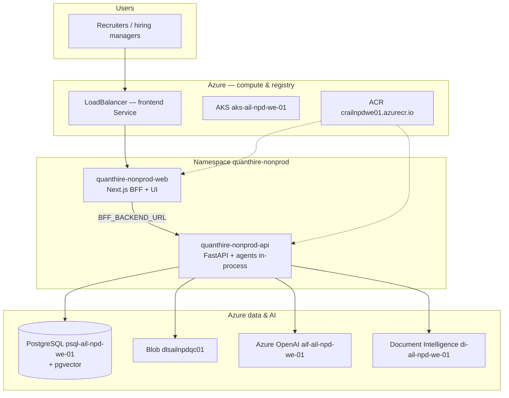
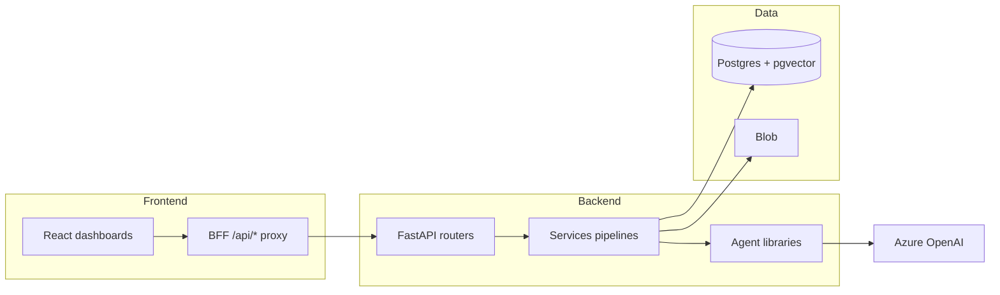

# QuantHire AI — KT Session 1: Architecture & Resources  
## Presenter pack (diagrams + full script)

**Session agenda (today)**  
1. End-to-end architecture walkthrough, supported by an architecture diagram  
2. Components and how they interact (frontend, backend, agents, data layer)  
3. Infrastructure and services: Azure resources, database, vector store, LLM services, etc.  
4. Rationale behind each resource: why selected, alternatives considered, trade-offs  

**Environment:** Malomatia Non-Prod — https://quanthire-npd.malomatia.com  
**Canonical deploy:** `infra/kubernetes/nonprod/quanthire.yaml`, namespace `quanthire-nonprod`, images e.g. `crailnpdwe01.azurecr.io/quanthire-backend:0.1.5`

---

# Part A — Reference material (keep open while presenting)

## A.1 Architecture diagram (primary)

## A.2 Four AI capabilities (product map)

| Capability | Where in UI | Implementation |
|------------|-------------|----------------|
| JD generation | Jobs → Generate JD | LangGraph workflow in `apps/agents/agents/jd_generation` |
| Resume parsing | Candidates → upload | Blob → DI → ParsingAgent → Postgres + pgvector |
| Job matching | Job matching | HSS-D swarm + debate in `job_matching` |
| QuantChat | QuantChat | QueryRouter RAG in `apps/quantchat` |

**Cross-cutting:** RBAC, JWT auth, AI Hub usage logging (`usage_log`), AI adoption dashboard, optional LangSmith / App Insights.

## A.3 Monorepo map

| Folder | Role |
|--------|------|
| `apps/web` | Next.js 14, BFF proxy, dashboards |
| `apps/api` | FastAPI, DB, services, REST `/api/v1` |
| `apps/agents/agents` | JD, matching, parsing, LLM factory |
| `apps/quantchat` | RAG pipeline (QueryRouter) |
| `apps/worker` | Celery (not running on NPD — replicas 0) |
| `infra/kubernetes/nonprod/` | NPD kubectl manifest |

## A.4 Azure NPD resource cheat sheet

| Service | Name / endpoint | Used for |
|---------|-----------------|----------|
| Resource group | `rg-ail-wkload-npd-we-01` | Workloads |
| AKS | `aks-ail-npd-we-01` | Web + API pods |
| ACR | `crailnpdwe01.azurecr.io` | Container images |
| PostgreSQL | `psql-ail-npd-we-01.postgres.database.azure.com`, DB `quanthire_ai` | App data + pgvector |
| Azure OpenAI | `aif-ail-npd-we-01.openai.azure.com` | Chat `gpt-4o`, embeddings `text-embedding-3-large` |
| Storage | `dlsailnpdqc01` | Resume uploads / processed |
| Document Intelligence | `di-ail-npd-we-01` | PDF layout extraction |
| Namespace | `quanthire-nonprod` | Deployments `quanthire-nonprod-api`, `quanthire-nonprod-web` |

**Secrets (AKS only):** DB URL, blob string, AOAI key, DI key, JWT, optional Entra secret.

## A.5 Rationale summary table (agenda item 4)

| Decision | Why we chose it | Alternatives | Main trade-off |
|----------|-----------------|--------------|----------------|
| AKS + web/API (2 services) | Fits AI Hub landing zone; BFF pattern | App Service only, many microservices | Simple NPD; agents live in API pod — scaling needs care |
| Postgres + pgvector | One DB for relational + vectors | Milvus, Pinecone, Qdrant | Simpler ops; less specialized than dedicated vector DB |
| Azure OpenAI on NPD | Enterprise Azure AI contract | Vertex (local dev), public OpenAI, Groq | Single supported inference plane; model cost |
| Document Intelligence | Quality PDF/resume extraction | PyPDF-only | Per-page cost vs accuracy |
| Blob storage | Durable files, reprocess | Local disk | Secret + cost vs reliability |
| Next.js BFF | Hide backend URL, cookies, long JD timeouts | Browser → public API | Extra hop; negligible inside cluster |
| Milvus off on Azure | Replatform to pgvector | Keep Milvus cluster | Local dev still has Milvus paths; NPD is pgvector-only |
| Usage metrics in Postgres | AI Hub standard schema | App Insights only | Optional dual telemetry; canonical adoption in DB |

## A.6 Component interaction (logical)

---

# Part B — Presenter script (read or adapt)

**Total suggested time:** 50–60 minutes (adjust pauses for questions).  
**Tip:** Speak in complete sentences; pause after each **[PAUSE]**; switch screen at **[SHOW]**.

---

## Block 0 — Welcome & scope (2 min)

**[SHOW]** Title slide or README one-liner.

**Script:**

“Good morning / afternoon, everyone. Thanks for joining Session 1 of the QuantHire knowledge transfer. Today’s focus is **Architecture and Resources**, exactly per the agenda: we’ll do an **end-to-end architecture walkthrough** with a diagram, explain **how the frontend, backend, agents, and data layer interact**, list the **Azure and AI services** we use in Non-Prod, and for each major choice I’ll cover **why we selected it, what alternatives existed, and the trade-offs**.

This session is about the **system as deployed today** on Malomatia Non-Prod — URL **quanthire-npd.malomatia.com** — not a future roadmap. Deep dives on individual agents can come in later sessions.

Any questions on scope before we start?”

**[PAUSE]**

---

## Block 1 — What QuantHire is (3 min)  
*Maps to: set context before architecture*

**Script:**

“QuantHire is an **AI-native hiring platform** built for Malomatia. Recruiters and hiring managers use a single web application for the hiring workflow, with **four major AI capabilities** embedded in the product.

**First**, **autonomous JD generation**: from an HR matrix — title, level, department, skills, and so on — we generate a **fifteen-section enterprise job description**, with human review before publish.

**Second**, **resume parsing and intelligence**: users upload a CV; we extract structured profile data and store it for search and matching.

**Third**, **job matching**: we score and explain fit between a candidate and a job using a **multi-agent matching architecture** with specialist agents and a debate layer.

**Fourth**, **QuantChat**: a conversational assistant that answers questions over **indexed job and candidate knowledge** using a **RAG pipeline** — retrieval augmented generation.

Across all of these we have **role-based access control**, **authentication**, and **AI adoption metrics** aligned with the **AI Hub usage logging pattern** — events in Postgres plus an in-app adoption dashboard.

I’ll now zoom out to how all of this is wired in Azure.”

**[PAUSE]**

---

## Block 2 — End-to-end architecture walkthrough (10 min)  
*Agenda item 1: E2E + diagram*

**[SHOW]** Diagram **A.1** (full platform).

**Script:**

“Here is the **end-to-end architecture** for Non-Prod.

**Users** — recruiters — open the browser and hit our public Non-Prod URL. Traffic lands on **Azure Kubernetes Service**, cluster name **aks-ail-npd-we-01**, in resource group **rg-ail-wkload-npd-we-01**.

Inside the cluster, namespace **quanthire-nonprod**, we run **two main deployments**:

1. **quanthire-nonprod-web** — a **Next.js** application. It serves the UI and acts as a **Backend-for-Frontend**, or **BFF**.

2. **quanthire-nonprod-api** — **FastAPI**. This is the **brain** for business logic, database access, and **AI agent execution**.

Container images are pulled from **Azure Container Registry**, **crailnpdwe01.azurecr.io**, with tags like **quanthire-backend** and **quanthire-frontend** — for example version **0.1.5**.

**Critical path for every API call:** the browser only talks to **same-origin** paths under **`/api`**. The Next.js server **proxies** those requests to the internal service **`quanthire-backend`** on port **8000** using the environment variable **`BFF_BACKEND_URL`**. The FastAPI URL is **not** exposed to the client. That gives us cleaner **security**, **cookie handling**, and we can set **long proxy timeouts** for operations like JD generation that can run many minutes.

From the API pod, outbound connections go to four Azure-backed dependency groups:

1. **Azure Database for PostgreSQL** — host **psql-ail-npd-we-01**, database **quanthire_ai**. This holds **all relational data** and, importantly, **vector embeddings** via the **pgvector** extension. On Non-Prod we do **not** run a separate Milvus cluster.

2. **Azure Blob Storage** — account **dlsailnpdqc01**, containers for **uploads** and **processed** files — primarily **resumes**.

3. **Azure OpenAI** — resource **aif-ail-npd-we-01**. Chat deployment **gpt-4o** and embedding deployment **text-embedding-3-large** power the agents.

4. **Azure AI Document Intelligence** — **di-ail-npd-we-01** — for **layout-aware extraction** from PDF resumes before LLM parsing.

One architectural point I want to state clearly: **agent code is not a separate microservice on Non-Prod**. JD generation, job matching, resume parsing agents, and QuantChat’s QueryRouter run **in-process** inside the API container — imported as Python packages. We traded **service isolation** for **operational simplicity** on NPD. The trade-off is a **heavier API pod** and some **scaling constraints** I’ll mention later.

Does the diagram make sense before we break down layers?”

**[PAUSE — take questions on the diagram only]**

---

## Block 3 — Components & interactions (15 min)  
*Agenda item 2: frontend, backend, agents, data*

### 3a — Frontend (4 min)

**[SHOW]** `apps/web` tree or architecture slide **A.6**.

**Script:**

“**Frontend layer — Next.js**, under **`apps/web`**.

We use the **App Router** with dashboard routes for **jobs**, **candidates**, **job matching**, **QuantChat**, and **AI adoption** analytics.

**Authentication:** middleware protects routes; the API issues a **JWT**; the BFF forwards **Authorization** and **cookies** to FastAPI.

The most important file for integration is the **catch-all API route** under **`app/api/[...path]`**. Every browser call to **`/api/v1/...`** is forwarded to FastAPI. That’s the **BFF pattern**: the UI uses a single origin; we avoid CORS complexity and we don’t publish an internal cluster DNS name to the browser.

Feature components — for example **JD generation dialog**, **resume upload**, **QuantChat** — call a typed client in **`lib/api.ts`**. For JD, we prefer **async generation** with polling, with a **sync fallback** and a **ten-minute** timeout because agent workflows can be slow.

We also have optional **Application Insights** on the client, but **canonical AI adoption metrics** come from the **backend usage API**, not from the browser alone.

**[PAUSE]**

### 3b — Backend (4 min)

**[SHOW]** `apps/api/app/api/v1/__init__.py` or router list.

**Script:**

“**Backend layer — FastAPI**, under **`apps/api`**.

The application exposes versioned REST under **`/api/v1`**. Public routes include **auth**; protected routes require an authenticated user. Domain routers include **jobs**, **candidates**, **applications**, **jd-generation**, **job-matching**, **quantchat**, **resume-parsing**, and **usage** for AI Hub feedback and adoption summaries.

**Middleware** includes CORS, **RBAC** permission checks, rate limiting, security headers, structured logging, and global error handling.

**Services** sit between routers and agents — for example **`ResumePipelineService`** orchestrates blob reference, document text, parsing, and pgvector ingest; **`JDPipelineService`** persists generated JDs; **`PgVectorIngestionService`** is shared for RAG indexing.

**Database access** is async SQLAlchemy / SQLModel. Schema changes go through **Alembic** migrations — typically **`alembic upgrade head`** after deploy.

On startup, the API may connect optional infrastructure — for example **Milvus is skipped on Azure** when disabled in config — and initializes LLM environment from **`chat_factory`**.

**[PAUSE]**

### 3c — Agents (4 min)

**Script:**

“**Agent layer** — Python packages under **`apps/agents/agents`** and **`apps/quantchat`**, loaded into the API process.

**JD generation** uses a **LangGraph state machine**: context gathering with RAG-like retrieval, then generate, refine, validate, and prepare. The API **always reapplies the HR matrix** after the LLM so recruiter-facing fields match what was entered in the form — that’s a deliberate **two-layer** design: agents draft, API enforces business rules.

**Resume parsing** uses a **ParsingAgent** — LLM structured extraction — after Document Intelligence gives us text.

**Job matching** uses an orchestrator described as **HSS-D**: parallel **specialist agents**, then a **debate** between synthesizer, critic, and arbitrator, then HR-oriented insights. The API can return JSON or stream events for the live UI.

**QuantChat** centers on **`QueryRouter`**: classify intent, normalize the query, run **hybrid retrieval** — vector plus keyword — fuse ranks, rerank, build context, and generate an answer with citations. On Azure, vector retrieval reads **pgvector** in Postgres — the same store we write during ingest.

**LLM calls** on Non-Prod go through **`create_chat_llm`** with **`LLM_PROVIDER=azure_openai`**. The codebase also supports Vertex, public OpenAI, and others for **local development**, but NPD standardizes on **Azure OpenAI**.

Note: we have an **LLM Gateway** module with Redis-backed budgeting for some agent patterns; **JD, matching, and QuantChat hot paths today call chat models directly**, not through that gateway. That’s an integration point for a future session.

**[PAUSE]**

### 3d — Data layer (3 min)

**Script:**

“**Data layer** — three tiers on NPD.

**PostgreSQL** is the **system of record**: users, jobs, candidates, applications, audit, and **AI Hub tables** **`usage_log`** and **`usage_feedback`**.

**pgvector** in the same database stores **embeddings** for document chunks — job descriptions, resume content — so QuantChat and matching read from **one canonical vector store** on Azure.

**Azure Blob** holds **binary files** — the original upload and optionally processed artifacts — so we can re-run extraction if models improve.

Historically, **local development** used **Milvus** as a vector database. The **Azure replatform** set **`MILVUS_ENABLED=false`** and **`VECTOR_STORE=pgvector`**. Code paths for Milvus remain for local dev, but **Non-Prod is pgvector-only** — that reduces moving parts and aligns with managed PostgreSQL.

**[PAUSE — questions on components]**

---

## Block 4 — Walk one request end-to-end (8 min)  
*Reinforces agenda items 1 & 2*

**[SHOW]** Optional: JD dialog or QuantChat UI.

**Script — pick JD (recommended):**

“Let me tie the layers together with **JD generation**.

1. User opens **Jobs**, clicks **Generate JD**, fills the **HR matrix**, and submits.

2. The dialog calls **`/api/v1/jd-generation/generate-async`**. The BFF forwards to FastAPI, which validates input and starts a background task — or falls back to **sync generate** if needed.

3. FastAPI invokes **`JDGenerationOrchestrator`**, which runs the **LangGraph workflow** — context, generate, refine, validate.

4. The API **stamps HR fields**, then on NPD **auto-saves** to Postgres and **ingests vectors** for search.

5. The UI polls **generate-status**, shows **agent thoughts** and the preview; the user edits, saves, or exports — for example **Malomatia Word template**.

6. A **usage_log** run event is written for adoption metrics; the user can leave **star feedback** linked to **`usage_event_id`**.

Same pattern elsewhere: **resume** is Blob → DI → parse → Postgres + vectors; **QuantChat** is QueryRouter → pgvector retrieval → answer.”

**[PAUSE]**

---

## Block 5 — Infrastructure & Azure services (10 min)  
*Agenda item 3*

**[SHOW]** Table **A.4** or `infra/kubernetes/nonprod/quanthire.yaml` ConfigMap section.

**Script:**

“I’ll walk the **infrastructure inventory** for Non-Prod.

**Compute:** **AKS** hosts two deployments, typically **one replica each** on NPD for API and web. **Worker** deployment for Celery exists in the repo but **replica count is zero** — we’re not running a Redis broker on NPD for background workers in the current manifest.

**Registry:** **ACR crailnpdwe01** stores immutable images; CI or manual build pushes tags; the manifest pins image digests/tags.

**Configuration:** non-secret settings live in a **ConfigMap** — deployment target **azure-nonprod**, **LLM_PROVIDER azure_openai**, endpoints for Postgres, OpenAI, Blob, Document Intelligence, **vector store pgvector**, **Milvus disabled**.

**Secrets:** connection strings and API keys are **Kubernetes secrets** — database URL, blob connection string, Azure OpenAI key, Document Intelligence key, JWT secret, and Entra client secret when SSO is enabled. **Nothing secret is in Git.**

**Networking:** backend service is **ClusterIP**; frontend is exposed via **LoadBalancer** / public DNS **quanthire-npd.malomatia.com**. API is reachable **only inside the cluster** from the BFF.

**Database:** **Azure PostgreSQL Flexible Server**, SSL required, database name **quanthire_ai**.

**AI inference:** **Azure OpenAI** in the same landing zone pattern as other AI Hub apps.

**Observability on NPD:** structured logs at INFO; Prometheus may be disabled in ConfigMap; **LangSmith** optional; **Sentry** optional; **AI adoption dashboard** reads Postgres aggregates.

**Deploy path:** GitHub workflow **deploy-nonprod** validates unit tests and web build, pushes images, applies **`quanthire.yaml`**, then migrations.

**[PAUSE]**

---

## Block 6 — Rationale, alternatives, trade-offs (10 min)  
*Agenda item 4*

**[SHOW]** Table **A.5**.

**Script:**

“Last structured block: **why each major resource**, not just **what**.

**AKS with two services instead of many microservices:** We needed to land on the **enterprise AI Hub Kubernetes footprint** quickly. Splitting **web** and **api** gives us a clean **BFF boundary** without operating ten separate agent services. Alternative was **Azure Container Apps** or **App Service** only — fewer knobs but less alignment with sibling AI workloads. **Trade-off:** scaling the API horizontally is **not transparent** today because some features use **in-memory task state** — for example JD async poll — and **singleton orchestrators**.

**PostgreSQL plus pgvector instead of Milvus on Azure:** We wanted **one managed database** for transactional data and vectors — simpler backup, security review, and migrations. Alternatives were **Milvus**, **Pinecone**, **Qdrant** — still referenced in config for local or experiments. **Trade-off:** pgvector is **good for our NPD scale** but not the same as a dedicated vector database at huge QPS.

**Azure OpenAI for NPD inference:** Contract, region, and supportability with the Azure AI landing zone. Code supports **Vertex Gemini** locally — that’s what many developers use on laptops with **Application Default Credentials**. **Trade-off:** model choice and cost are tied to **gpt-4o**-class deployments; we’re not multi-cloud on NPD.

**Document Intelligence:** Resume quality drives everything downstream. PyPDF-only was insufficient for complex layouts. **Trade-off:** per-page cost vs parsing accuracy.

**Blob storage:** Durable uploads and reprocessing. **Trade-off:** another secret and storage cost vs losing files on pod restart.

**BFF in Next.js:** Security and timeout control. **Trade-off:** one extra hop — negligible inside the same cluster.

**AI adoption in Postgres:** Matches **AI Hub LogService** schema — **`usage_log`**, feedback, optional nightly rollup to a collector URL. App Insights is **supplementary**. **Trade-off:** we operate the data; we gain **consistent metrics** with sister apps.

**LangGraph checkpoint memory on NPD:** Config chooses **in-memory checkpoint** to avoid Postgres checkpointer operational issues on UAT. **Trade-off:** no durable mid-graph resume after pod restart.

**[PAUSE — open discussion on platform alignment]**

---

## Block 7 — Close & handoff (2 min)

**Script:**

“To summarize Session 1: QuantHire on NPD is a **Next.js BFF plus FastAPI API on AKS**, agents **in-process**, **PostgreSQL with pgvector** as system of record and vector store, **Azure OpenAI** for inference, **Blob and Document Intelligence** for documents, and **AI Hub-style usage logging** for adoption.

Later sessions can go deeper into **each agent**, **security**, **deploy runbooks**, and **matching debate logic**. 

What topics do you want prioritized in Session 2?”

**[PAUSE — thank the group]**

---

# Part C — Quick Q&A crib sheet

| Question | Answer |
|----------|--------|
| Is this microservices? | **Two K8s services**; agents are **libraries in API**, not separate pods. |
| Where are vectors? | **pgvector in Postgres** on NPD; Milvus **off**. |
| Where is LLM? | **Azure OpenAI** on NPD; Vertex/OpenAI etc. for local dev. |
| How does browser reach API? | **Same-origin `/api/*`** → BFF → cluster **`quanthire-backend:8000`**. |
| AI Hub connection? | **usage_log** schema, adoption API/UI, optional **rollup CronJob** + collector URL. |
| Auth on NPD? | Config supports **basic** and **Entra IDs**; exact mode is in ConfigMap **`AUTH_MODE`**. |
| Scale risks? | **Multi-worker Uvicorn**, **in-memory JD tasks** — need DB-backed tasks or sync path if scaling out. |
| Canonical deploy file? | **`infra/kubernetes/nonprod/quanthire.yaml`**. |

---

# Part D — Files to open if sharing screen

1. `infra/kubernetes/nonprod/quanthire.yaml` — ConfigMap + deployments  
2. `apps/api/app/config.py` — Azure resource names  
3. `apps/web/src/app/api/[...path]/route.ts` — BFF  
4. `docs/jd-generation-architecture.md` — JD deep dive (optional)  
5. `docs/kt-session-1-architecture-and-resources.md` — extended reference without script  

---

*End of presenter pack.*
