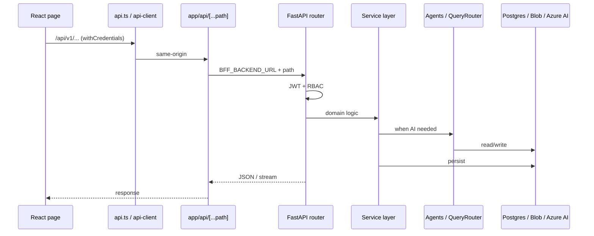

# Session 2 — Code Walkthrough (complete reference)

**QuantHire AI — Thursday KT (Code Walkthrough)**  
**Agenda coverage**

1. Repository structure and project layout  
2. Core modules and application flow (backend + frontend)  
3. Key implementation areas: authentication, data access, integrations, configuration  
4. Build, deployment, and local setup  
5. Known limitations and maintenance awareness  

**Companion:** Session 1 architecture — `docs/session-1-architecture-and-resources-complete.md`

---

# 1. Repository structure and project layout

## 1.1 Top-level map

```
/workspace  (repo root)
├── apps/                    # All application code
│   ├── web/                 # Next.js frontend + BFF
│   ├── api/                 # FastAPI backend
│   ├── agents/              # AI agents (JD, matching, parsing, LLM)
│   ├── quantchat/           # QueryRouter RAG pipeline
│   ├── worker/              # Celery worker (optional; off on NPD)
│   └── langgraph_app/       # LangGraph Studio / dev tooling
├── infra/                   # Kubernetes, Helm, Terraform, monitoring
├── tests/                   # pytest (unit + fixtures)
├── docs/                    # KT and architecture docs
├── .github/workflows/       # CI and deploy pipelines
├── Dockerfile.backend       # API image (build from repo root)
├── Dockerfile.frontend      # Web image (build from repo root)
├── .env.example             # Root env template (Vertex/local)
└── requirements-complete.txt
```

**Rule of thumb for the walkthrough:** Product code lives under **`apps/`**; **`infra/`** is how it runs on Azure; **`tests/`** gates CI.

## 1.2 `apps/web` — frontend layout

| Path | Purpose |
|------|---------|
| `src/app/` | Next.js App Router pages |
| `src/app/login/` | Login (basic + Entra hooks) |
| `src/app/dashboard/` | Authenticated product UI |
| `src/app/api/[...path]/route.ts` | **BFF proxy** to FastAPI |
| `src/components/` | UI components (jobs, candidates, QuantChat, auth) |
| `src/contexts/auth-provider.tsx` | Auth state, login/logout |
| `src/lib/api.ts` | Axios client → `/api/v1/*` |
| `src/lib/api-client.ts` | Fetch wrapper, `credentials: include` |
| `src/lib/auth-storage.ts` | User in sessionStorage; **JWT in HttpOnly cookie** |
| `src/lib/msal-auth.ts` | Microsoft Entra / MSAL |
| `middleware.ts` | Redirect `/dashboard/*` if no session cookie |

**Dashboard routes (examples):**

- `dashboard/jobs`, `dashboard/jobs/[id]` — JD generation entry  
- `dashboard/candidates`, `dashboard/candidates/[id]` — resume upload  
- `dashboard/job-matching` — matching UI  
- `dashboard/chat` — QuantChat page  
- `dashboard/applications`, `interviews`, `offers`, `assessments`, `analytics`, `settings`

## 1.3 `apps/api` — backend layout

| Path | Purpose |
|------|---------|
| `app/main.py` | FastAPI app, lifespan, middleware, router mount |
| `app/config.py` | Settings (pydantic-settings, Azure defaults) |
| `app/database.py` | Async engine, sessions, health |
| `app/api/v1/` | Versioned REST routers |
| `app/api/v1/__init__.py` | Public vs protected router split |
| `app/core/` | Security, deps, auth policy, session cookies, exceptions |
| `app/middleware/` | RBAC, rate limit, logging |
| `app/models/` | SQLModel tables |
| `app/services/` | Business pipelines (resume, JD, pgvector, usage) |
| `app/integrations/` | Azure Blob, Document Intelligence, Entra, Graph |
| `app/repositories/` | User loading helpers |
| `alembic/` | DB migrations |

## 1.4 `apps/agents` — agent layout

| Path | Purpose |
|------|---------|
| `agents/jd_generation/` | LangGraph workflow, orchestrator, crew_agents |
| `agents/job_matching/` | HSS-D orchestrator, specialists, debate |
| `agents/parsing/` | Resume ParsingAgent |
| `agents/llm/` | `chat_factory`, gateway, client |
| `agents/base/` | Shared agent abstractions |
| `prompts/*.yaml` | Prompt specs (spec, parsing, decision, offer) |

## 1.5 `apps/quantchat` — RAG layout

| Path | Purpose |
|------|---------|
| `core/query_router.py` | Main RAG orchestration |
| `core/intent_classifier.py` | Route RAG vs general |
| `retrieval/` | Vector, keyword, pgvector, full-doc |
| `fusion/rrf_fusion.py` | Hybrid merge |
| `reranking/reranker.py` | Cross-encoder style rerank |
| `generation/` | RAG + general LLM answers |

## 1.6 `infra/` — operations layout

| Path | Purpose |
|------|---------|
| `kubernetes/nonprod/quanthire.yaml` | **Canonical NPD deploy** (kubectl apply) |
| `kubernetes/nonprod/quanthire-secrets.yaml` | Secret template (placeholders) |
| `kubernetes/helm/quanthire/` | Helm chart (reference; staging/prod values) |
| `terraform/azure/` | IaC modules (AKS, Postgres, Redis, ACR, Key Vault, …) |
| `monitoring/` | Prometheus/Grafana samples |

## 1.7 `tests/`

| Path | Purpose |
|------|---------|
| `tests/unit/` | Fast unit tests (auth, JD, matching, config, manifest) |
| `tests/conftest.py` | Shared fixtures |
| `tests/fixtures/` | Sample JD JSON, resume text |

CI runs `pytest tests/unit` with `PYTHONPATH` including api, agents, quantchat.

---

# 2. Core modules and application flow

## 2.1 End-to-end request flow (every feature)



**Two HTTP clients on the frontend (know both):**

- **`apiClient` (axios)** in `lib/api.ts` — most feature APIs, long timeout.  
- **`apiFetchJson`** in `lib/api-client.ts` — auth bootstrap (`/v1/auth/me`).

Both use **`baseURL: /api`** and **`withCredentials: true`**.

## 2.2 Backend router architecture

File: `apps/api/app/api/v1/__init__.py`

```text
public_router   → auth (login), usage status, health-related public bits
protected_router → Depends(require_authenticated_user) on ALL routes

Final mount in main.py: app.include_router(api_v1_router, prefix="/api/v1")
```

**Pattern:** Default **deny**; individual handlers use `allow_anonymous_user` or live on `public_router`.

## 2.3 Feature → code map (walkthrough order)

| Feature | Frontend entry | API router | Agent / service |
|---------|----------------|------------|-----------------|
| Login | `login/page.tsx`, `auth-provider.tsx` | `auth.py` | `user_loader`, `security.verify_token` |
| Jobs / JD | `jd-generation-dialog.tsx`, jobs pages | `jd_generation.py` | `jd_generation/orchestrator`, `jd_pipeline_service` |
| Resume | `ResumeUpload.tsx`, candidates pages | `resume_parsing.py`, `candidates.py` | `resume_pipeline_service`, `ParsingAgent` |
| Matching | `job-matching/page.tsx`, match views | `job_matching.py` | `job_matching/orchestrator` |
| QuantChat | `QuantChat.tsx`, `dashboard/chat` | `quantchat.py` | `quantchat.QueryRouter` |
| LLM gateway (stub) | — | `llm_gateway.py` | Placeholder metrics |

## 2.4 JD flow (code path)

1. `handleGenerate` in `jd-generation-dialog.tsx`  
2. `api.jdGeneration.generateAsync` → BFF → `POST /api/v1/jd-generation/generate-async`  
3. `jd_generation.py` → `_execute_jd_generation_core`  
4. Thread: `JDGenerationOrchestrator.generate_job_description`  
5. `state_machine.py` LangGraph invoke  
6. `_apply_hr_inputs_to_jd`  
7. `JDPipelineService.store_jd` + `PgVectorIngestionService`  
8. Poll `GET .../generate-status/{task_id}` or sync `/generate`

## 2.5 Resume flow (code path)

1. Upload component → API upload/parse endpoints  
2. `integrations/azure_blob.py` — store file (NPD)  
3. `integrations/document_intelligence.py` — extract text  
4. `ResumePipelineService` + `ParsingAgent`  
5. Models: `Candidate`, `CandidateEmbedding`, `document_chunks`  
6. `PgVectorIngestionService` for RAG index  

## 2.6 QuantChat flow (code path)

1. `quantchat.py` chat handler  
2. `get_query_router()` → `QueryRouter.route_query`  
3. `_handle_rag_pipeline`: filters → query expand → **vector + keyword** retrieve → RRF → rerank → generate  
4. On Azure: `PgVectorRetriever`, `search_chunks_by_keywords`  

## 2.7 Matching flow (code path)

1. `job_matching.py` endpoints (JSON + SSE stream paths)  
2. `JobMatchingOrchestrator.run` / `.stream`  
3. `data_access_pg.py` on Azure for candidate/JD load  
4. Specialist + debate agents → response DTOs to UI  

## 2.8 Docker runtime layout (why imports work)

From `Dockerfile.backend`:

```text
/app          → apps/api (FastAPI)
/agents       → apps/agents
/srv/apps/quantchat → apps/quantchat (import as apps.quantchat)

PYTHONPATH=/app:/agents:/agents/agents:/srv:/srv/apps
CMD: uvicorn app.main:app --workers ${UVICORN_WORKERS:-2}
```

**Maintenance note:** Local dev must mirror `PYTHONPATH` (see CI env in deploy workflow).

---

# 3. Key implementation areas

## 3.1 Authentication

### 3.1.1 Modes (`app/config.py`, ConfigMap)

| `AUTH_MODE` | Behavior |
|-------------|----------|
| `none` | Local dev — protected router may not enforce JWT |
| `basic` | Email/password vs Postgres `users` (NPD) |
| Entra | MSAL in browser + token validation in `integrations/entra_auth.py` |

`auth_enforced()` in `core/auth_policy.py`: **true** for `basic` and **`azure-nonprod`**.

### 3.1.2 Login → session (backend)

File: `apps/api/app/api/v1/auth.py`

1. Validate credentials (or Entra token).  
2. `create_access_token` (`core/security.py`).  
3. `attach_session_cookies(response, access_token)` — **`quanthire_session`** HttpOnly cookie.  
4. In hardened envs: `should_omit_token_from_body()` — **JWT not returned in JSON body** (cookie-only).

File: `apps/api/app/core/session_cookie.py`

- Cookie name: `quanthire_session` (matches `middleware.ts` check).  
- `secure`, `samesite=strict`, `httponly`.

### 3.3.3 Session on frontend

File: `apps/web/src/lib/auth-storage.ts`

- **JWT is NOT in localStorage** — `getAccessToken()` returns null by design.  
- **User profile** (id, email, name, role) in **sessionStorage** for UI.  
- All API calls: **`credentials: include`** so cookie goes to BFF → API.

File: `apps/web/middleware.ts`

- Guards **`/dashboard/*`**: redirects to `/login?next=...` if cookie missing.

File: `apps/web/src/contexts/auth-provider.tsx`

- Bootstrap: `GET /v1/auth/me` via `apiFetchJson`.  
- Login: POST auth → cookies set via BFF forwarding `Set-Cookie`.  
- Entra: `loginWithMicrosoft` from `msal-auth.ts`.

### 3.1.4 Per-request auth (backend)

File: `apps/api/app/core/deps.py` — `get_current_user`

1. Token from cookie **or** `Authorization: Bearer` **or** query (legacy).  
2. `verify_token` → load user from DB.  
3. Attach `request.state.user`.

### 3.1.5 RBAC

File: `apps/api/app/middleware/rbac.py`

- `Permission` enum (`VIEW_CANDIDATE_PII`, `RUN_AGENTS`, …).  
- `ROLE_PERMISSIONS` map.  
- `require_permission([...])` on sensitive routes (e.g. analytics when present).

**Walkthrough tip:** Show login in `auth.py` + cookie attach + `deps.get_current_user` + one protected route’s `Depends`.

---

## 3.2 Data access

### 3.2.1 Database connection

File: `apps/api/app/database.py`

- Builds **asyncpg** URL from `DATABASE_URL`.  
- Strips/translates `sslmode=require` for Azure.  
- `async_session_maker` for route handlers and services.  
- `get_session` dependency for FastAPI.  
- Health: `check_db_health()`.

### 3.2.2 Models (SQLModel)

Directory: `apps/api/app/models/`

| Model file | Domain |
|------------|--------|
| `users.py`, `organizations.py` | Auth, tenancy |
| `jobs.py` | Jobs + enterprise JD JSON |
| `candidates.py` | Profiles, resume metadata |
| `applications.py`, `interviews.py`, `offers.py` | Pipeline |
| `document_chunks.py` | RAG chunks + vectors |
| `audit_logs.py` | Audit trail |
| `feedback.py`, `assessments.py` | HR workflows |

Usage logging models may live in `usage_logs.py` on branches where AI Hub metrics are merged — check `alembic/versions` for your branch.

### 3.2.3 Migrations

```bash
cd apps/api
alembic upgrade head
alembic revision --autogenerate -m "description"   # when changing models
```

Key revisions in repo:

- `0001_initial_schema.py`  
- `add_document_chunks_pgvector.py`  
- `migrate_embeddings_to_bge.py`  
- `add_viewer_user_role_enum.py`

### 3.2.4 Vector / chunk access

File: `apps/api/app/services/pgvector_ingestion.py`

- Central **write** path for chunks/embeddings.  
- Keyword search helper used by QuantChat keyword retriever on Azure.

File: `apps/agents/agents/job_matching/data_access_pg.py`

- **Read** path for matching on pgvector-backed data.

### 3.2.5 Repository pattern

Lightweight — e.g. `repositories/user_loader.py` for auth user rows. Most routes use services + SQLModel queries directly.

---

## 3.3 Integrations

| Integration | File | Used by |
|-------------|------|---------|
| Azure Blob | `integrations/azure_blob.py` | Resume upload, file storage (NPD) |
| Document Intelligence | `integrations/document_intelligence.py` | PDF → text |
| Entra SSO | `integrations/entra_auth.py` | SSO login path |
| Microsoft Graph | `integrations/microsoft_graph.py` | Calendar/email (optional) |
| LinkedIn / GitHub | `integrations/linkedin.py`, `github.py` | Stubs / future sourcing |

Agents do **not** call Azure SDKs directly for LLM on NPD — they use **`chat_factory`** with env-configured Azure OpenAI.

---

## 3.4 Configuration

### 3.4.1 Backend settings

File: `apps/api/app/config.py` — class `Settings`

**Important groups:**

- `deployment_target`, `auth_mode`, `app_env`  
- Azure: postgres host, openai endpoint, storage, document intelligence  
- `database_url`, pool sizes  
- `vector_store_type`, `milvus_enabled`  
- `llm_provider`, models, JWT, CORS  
- Feature flags, Sentry, Prometheus  

Validators often **override defaults when `DEPLOYMENT_TARGET=azure-nonprod`** (e.g. force `azure_openai`, `pgvector`, `azure_blob`).

### 3.4.2 Environment file hierarchy

1. K8s ConfigMap + Secrets (NPD)  
2. Repo root `.env.example` (local / Vertex)  
3. `apps/web/.env.example` — `BFF_BACKEND_URL=http://localhost:8000`  
4. Agent `.env` paths discovered by `chat_factory.project_env_file_candidates()`

**Rule:** K8s env **must not** be overridden by accidental `load_dotenv(override=True)` in production — factory uses `override=False`.

### 3.4.3 Frontend config

- `BFF_BACKEND_URL` — server-side only (BFF).  
- `next.config.js` — standalone output, security headers, `NEXT_PUBLIC_USE_BFF`.

### 3.4.4 BFF long-running paths

File: `apps/web/src/app/api/[...path]/route.ts`

Extended timeout (~620s) for:

- `v1/jd-generation/generate*`  
- Resume upload paths  
- Job matching match/rank  
- SSE: `job-matching/match-stream`

**If you add a long AI endpoint, add it here** or the BFF will 504 first.

---

# 4. Build, deployment, and local setup

## 4.1 Prerequisites

| Tool | Version (CI) |
|------|----------------|
| Python | 3.11 |
| Node | 20 |
| PostgreSQL | 14+ (local or Azure) |
| Docker | For image parity |

Optional local: Vertex ADC or OpenAI key; Milvus only if testing legacy vector path.

## 4.2 Local development (typical)

### Backend

```bash
# From repo root — set DATABASE_URL, LLM_PROVIDER, etc. (see .env.example)
export PYTHONPATH="apps:apps/api:apps/agents:apps/agents/agents:apps/quantchat"
cd apps/api
pip install -r requirements.txt   # or requirements.linux.txt on Linux
alembic upgrade head
uvicorn app.main:app --reload --host 0.0.0.0 --port 8000
```

### Frontend

```bash
cd apps/web
cp .env.example .env.local   # BFF_BACKEND_URL=http://localhost:8000
npm ci --legacy-peer-deps
npm run dev    # port 3000
```

Browser: `http://localhost:3000` → API via BFF at `http://localhost:8000`.

### Tests (same as CI)

```bash
export JWT_SECRET_KEY="test-jwt-secret-key-with-32-chars-minimum"
export APP_ENV=testing
export AUTH_MODE=none
export PYTHONPATH=apps:apps/api:apps/agents:apps/agents/agents:apps/quantchat
pytest tests/unit -q
```

## 4.3 Production-style Docker build

From **repo root**:

```bash
docker build -f Dockerfile.backend --target production \
  -t crailnpdwe01.azurecr.io/quanthire-backend:0.1.5 .

docker build -f Dockerfile.frontend --target production \
  -t crailnpdwe01.azurecr.io/quanthire-frontend:0.1.5 .
```

Push to ACR, then deploy manifest.

## 4.4 Non-Prod deploy (canonical)

1. Apply secrets (cluster): `quanthire-secrets.yaml` with real values.  
2. `kubectl apply -f infra/kubernetes/nonprod/quanthire.yaml`  
3. Migrations:

```bash
kubectl exec deploy/quanthire-nonprod-api -n quanthire-nonprod -- alembic upgrade head
```

4. Logs:

```bash
kubectl logs -f deploy/quanthire-nonprod-api -n quanthire-nonprod
```

**GitHub Actions:** `.github/workflows/deploy-nonprod.yml` — validate (pytest + `tsc` + `next build`), build/push both images, kubectl apply, rollout restart, alembic, smoke health.

## 4.5 What gets copied into the API image

| Source | Image path |
|--------|------------|
| `apps/api` | `/app` |
| `apps/agents` | `/agents` |
| `apps/quantchat` | `/srv/apps/quantchat` |

Changing agent code **requires backend image rebuild**, not web rebuild.

---

# 5. Known limitations and maintenance awareness

## 5.1 Scaling and concurrency

| Issue | Detail | What to do |
|-------|--------|------------|
| **JD async tasks** | In-memory dict in `jd_generation_tasks.py` | Single replica or sync `/generate`; future: Redis/DB queue |
| **Uvicorn workers** | Dockerfile default `UVICORN_WORKERS=2` | Multi-worker breaks in-memory JD poll; set **1** on NPD if async JD used |
| **Singleton agents** | Orchestrators/parsing agent lazy singletons | Expected per process; not shared across pods |
| **Celery worker off** | NPD replicas 0 | Long work runs in API; watch pod CPU/memory |

## 5.2 Data and time

| Issue | Detail |
|-------|--------|
| **Naive UTC timestamps** | Azure Postgres `TIMESTAMP WITHOUT TIME ZONE` — use `utc_now_naive()` in models/services |
| **Embedding model drift** | Migrations mention bge vs `text-embedding-3-large` — re-index if model changes |

## 5.3 Architecture drift / legacy

| Item | Status |
|------|--------|
| **Milvus** | Disabled on NPD; code paths remain for local |
| **LLM Gateway** | Initialized optionally; JD/matching/QuantChat often bypass |
| **llm_gateway.py routes** | Partially stubbed placeholder responses |
| **CrewAI JD path** | Not production hot path |
| **Helm vs raw YAML** | NPD = **raw `quanthire.yaml`**; don’t edit only Helm and expect NPD change |

## 5.4 Security maintenance

- Rotate secrets via K8s secrets, not Git.  
- JWT: `JWT_SECRET_KEY` length validation in hardened envs.  
- Never return JWT in response body when `should_omit_token_from_body()` is true.  
- RBAC: add new endpoints → assign `require_permission` where needed.

## 5.5 Frontend maintenance

- Two API clients (`api.ts` vs `api-client.ts`) — use the right one for new code (axios for features, fetch for auth bootstrap).  
- New long-running API → update BFF timeout list in `[...path]/route.ts`.  
- Dashboard guard is **cookie presence only** — full auth is API-side.

## 5.6 Testing before merge

- `pytest tests/unit`  
- `cd apps/web && npx tsc --noEmit && npm run build`  
- For manifest changes: `tests/unit/test_nonprod_manifest.py`

---

# 6. Suggested 60-minute walkthrough script (screen order)

| Min | Show | Say |
|-----|------|-----|
| 0–5 | Repo tree §1 | Monorepo: web, api, agents, quantchat, infra, tests |
| 5–12 | `apps/web/src/app/api/[...path]/route.ts` | BFF, timeouts, cookies |
| 12–18 | `auth-provider.tsx`, `session_cookie.py`, `deps.py` | Cookie session, no token in localStorage |
| 18–25 | `api/v1/__init__.py`, one router e.g. `candidates.py` | Public vs protected |
| 25–35 | `resume_pipeline_service.py` + `query_router.py` (skim) | Pipeline vs RAG |
| 35–42 | `jd_generation.py` + `state_machine.py` (diagram only) | LangGraph + HR stamp |
| 42–48 | `config.py` + nonprod ConfigMap | Env-driven Azure |
| 48–54 | Dockerfiles + deploy-nonprod.yml | Build and deploy |
| 54–60 | §5 limitations | Honest maintenance backlog |

---

# 7. Quick file index (bookmark for Session 2)

| Topic | Path |
|-------|------|
| FastAPI entry | `apps/api/app/main.py` |
| Routers | `apps/api/app/api/v1/` |
| Settings | `apps/api/app/config.py` |
| DB | `apps/api/app/database.py` |
| Auth API | `apps/api/app/api/v1/auth.py` |
| Auth deps | `apps/api/app/core/deps.py` |
| Cookies | `apps/api/app/core/session_cookie.py` |
| RBAC | `apps/api/app/middleware/rbac.py` |
| BFF | `apps/web/src/app/api/[...path]/route.ts` |
| Axios API | `apps/web/src/lib/api.ts` |
| Auth UI | `apps/web/src/contexts/auth-provider.tsx` |
| NPD manifest | `infra/kubernetes/nonprod/quanthire.yaml` |
| CI/CD | `.github/workflows/deploy-nonprod.yml` |

---

*End of Session 2 complete reference.*
